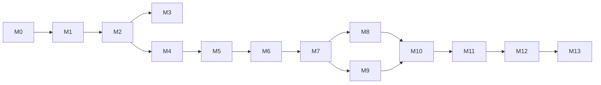

# EngineRUL — Product Requirements Document (PRD)

| Field | Value |
|---|---|
| Document | `PRD.md`, the primary implementation spec for EngineRUL |
| Version | 1.0 |
| Date | 2026-11-10 |
| Status | Ready for implementation |
| Audience | AI coding agents and the human developer who reviews their work |
| Scope | NASA C-MAPSS FD001 MVP, with FD002–FD004 and other items as optional extensions |

---

## How to use this document (instructions for coding agents)

1. Implement the milestones in **Section 10** in order. Do not start a milestone until the previous milestone's acceptance criteria pass.
2. Requirements carry IDs such as `DATA-07`. Code comments, tests, and commit messages should cite them where helpful (for example `# DATA-07: RUL label definition`).
3. **MUST** means required for the MVP. **SHOULD** means strongly recommended. **MAY** means optional.
4. **Never fabricate results.** Every number in the README, report, or figures must come from code that ran in this repository. Placeholder tables must say `TBD (not yet run)` and never hold made-up numbers.
5. **Never touch the official test set during development.** See `EVAL-20` through `EVAL-25`.
6. Section 3 sets the design decisions. If something here seems wrong, raise it as an issue or a note in `docs/decisions.md`. Do not redesign silently.
7. Avoid scope creep. Section 1.5 lists the non-goals. Section 1.4 lists the optional extensions, and they come only after the MVP is complete.

---

## Table of contents

1. Project definition and scope
2. Dataset and data engineering
3. Key design decisions and resolved ambiguities
4. Machine learning architecture
5. Evaluation methodology
6. Experiment tracking and reproducibility
7. Software architecture
8. Testing and verification
9. Benchmarking, visualization, and reporting
10. Development roadmap (milestones)
11. Risks and mitigations
12. Final portfolio presentation
13. Verified facts, unverified items, and references

---

## 1. Project definition and scope

### 1.1 Problem statement

Given an aircraft turbofan engine's multivariate sensor history up to its current operating cycle, predict its **Remaining Useful Life (RUL)**: the number of operating cycles left before failure.

The data is NASA's **C-MAPSS** simulated run-to-failure dataset. The MVP uses subset **FD001**: one operating condition, one fault mode (HPC degradation), 100 training engines, and 100 test engines.

### 1.2 Objectives

| ID | Objective |
|---|---|
| OBJ-1 | Build a reproducible, leakage-safe pipeline from raw C-MAPSS files to evaluated models. |
| OBJ-2 | Train and compare a progression of models: naive baselines → Ridge → gradient-boosted trees → one PyTorch LSTM. |
| OBJ-3 | Evaluate every model under one protocol on the official FD001 test set with RMSE, MAE, and the NASA asymmetric score, including uncertainty estimates. |
| OBJ-4 | Track every experiment (config, seed, data version, metrics, artifacts) in MLflow and machine-readable JSON. |
| OBJ-5 | Present results honestly in a README, a generated report, and generated figures. |

### 1.3 Target users

| User | Need |
|---|---|
| Recruiters and hiring managers (primary) | Understand the project's depth from the README in under two minutes: problem, method, real results, rigor. |
| ML engineers reviewing the repo | Check that the methodology is sound (no leakage, fair comparison, honest test use) and reproduce the results. |
| The developer | A clean, extensible codebase to learn from and extend to FD002–FD004. |

There are no end users who make maintenance decisions. This is a portfolio and research project on simulated data (see `SCOPE-NG-1`).

### 1.4 MVP and optional enhancements

**MVP (all required):**

| ID | Deliverable |
|---|---|
| MVP-1 | Verified FD001 data acquisition with pinned checksums |
| MVP-2 | Data loading, schema validation, and RUL labels |
| MVP-3 | EDA script that produces the required figures and a data-quality summary |
| MVP-4 | Committed engine-level train/validation split manifest |
| MVP-5 | Leakage-safe preprocessing: sensor selection, normalization, RUL capping, windowing, tabular features |
| MVP-6 | Metrics module (RMSE, MAE, NASA score, bias) with hand-verified unit tests |
| MVP-7 | Baselines: constant mean and cycle-based life prior |
| MVP-8 | Ridge regression and `HistGradientBoostingRegressor`, tuned on validation only |
| MVP-9 | PyTorch LSTM with training loop, validation, early stopping, checkpointing, and CPU/MPS/CUDA support |
| MVP-10 | Multi-seed final training and a one-time, logged test evaluation |
| MVP-11 | Benchmarks: training time, inference latency, model size |
| MVP-12 | Generated report (`reports/report.md`), figures, and machine-readable results |
| MVP-13 | README with methodology, real results, limitations, and reproduction instructions |
| MVP-14 | pytest suite covering parsing, labels, splits, leakage, windows, models, metrics, and an end-to-end smoke test |

**Optional enhancements (only after the MVP is complete, in suggested order):**

| ID | Enhancement |
|---|---|
| OPT-1 | Repeated engine-level cross-validation (5 folds) for model-selection variance |
| OPT-2 | Temporal Convolutional Network (TCN) as a second sequence model |
| OPT-3 | FD002–FD004, with per-operating-condition normalization |
| OPT-4 | SHAP explanations for the tree model |
| OPT-5 | Streamlit dashboard: pick an engine, view sensors, compare model predictions |
| OPT-6 | Random forest as an additional classical model |
| OPT-7 | Prediction intervals (for example, split-conformal on the validation engines) |
| OPT-8 | Dockerfile for CPU reproduction |

### 1.5 Non-goals

| ID | Non-goal |
|---|---|
| SCOPE-NG-1 | No claim of real-world airworthiness, maintenance validity, or flight-safety relevance. C-MAPSS is simulated. |
| SCOPE-NG-2 | No web application, REST API, database, message queue, orchestration framework (Airflow, Kubeflow), or cloud deployment. |
| SCOPE-NG-3 | No distributed training, no large hyperparameter sweeps, no AutoML. |
| SCOPE-NG-4 | No paid APIs, LLM integrations, or paid datasets. |
| SCOPE-NG-5 | No more than one deep sequence architecture in the MVP. |
| SCOPE-NG-6 | No chasing state-of-the-art numbers. The goal is a defensible methodology, not leaderboard rank. |
| SCOPE-NG-7 | No TensorFlow or Keras. |

### 1.6 Success criteria

Success is defined by **correctness, completeness, and honesty**, not by a target accuracy. This PRD sets no RMSE target and does not assume any model will beat another.

| ID | Criterion | How to verify |
|---|---|---|
| SC-1 | A clean checkout reproduces all MVP results with documented commands. | Follow the README on a fresh clone. `make reproduce` finishes, and the final metrics match committed `results/final/summary.json` within the tolerances in `REPRO-08`. |
| SC-2 | All automated tests pass on CPU. | `uv run pytest` exits 0. |
| SC-3 | The official test set is evaluated once per final model configuration, and each evaluation is logged. | `results/test_evaluations.jsonl` exists, and every entry references a config chosen before the test evaluation (`EVAL-23`). |
| SC-4 | Every number in the README traces to a generated artifact. | Each README results table states its source file. A reviewer can diff the table against `results/final/summary.json`. |
| SC-5 | Every model is evaluated on identical evaluation points with identical metrics. | `tests/test_fair_comparison.py` passes (`TEST-FAIR-*`). |
| SC-6 | Results include variability across seeds and a test-set bootstrap CI. | The report's tables show mean ± std over seeds and 95% bootstrap CIs. |
| SC-7 | Limitations and the simulated-data disclaimer are stated prominently. | The README has a "Limitations" section and a disclaimer near the top. |

**Aspirational, not required:** learned models (Ridge, HGB, LSTM) improve on the naive baselines, and the LSTM is competitive with the tree model. If they don't, the report says so and analyzes why. A negative result, honestly reported, still meets the success criteria.

---

## 2. Dataset and data engineering

### 2.1 Source and provenance

**Facts verified on 2026-11-10 during PRD preparation:**

- The data.gov catalog entry *CMAPSS Jet Engine Simulated Data* names NASA's Prognostics Center of Excellence (PCoE) as publisher. It lists the access level as "public", gives no license field, and lists a single resource, `https://data.nasa.gov/docs/legacy/CMAPSSData.zip`. From the PRD-writing environment, that URL redirected to a pre-signed S3 URL that returned **HTTP 403** to a HEAD request, and a ranged GET timed out. The official download should be treated as **unreliable or unavailable**, consistent with the project description.
- The Hugging Face mirror `SoyVitou/NASA-C-MAPSS-Turbofan-Engine` at revision **`4d14a0bf6248235bce31cbdacb297e03e0f75d52`** (last modified 2026-05-25) contains:
  - `data/`: the 12 original-format raw text files (`train_FD00x.txt`, `test_FD00x.txt`, `RUL_FD00x.txt`, x = 1–4). Its README says these are "the original raw `.txt` files".
  - `processed/FD00x/{train,test}.parquet`: restructured files with added column names and a computed `RUL` column. **These MUST NOT be used** (`DATA-03`).
  - The license field is `other`, and the README cites the NASA source and Saxena et al. (2008).
- All 12 raw files were downloaded from that revision. Their git blob hashes **match** the hashes in the Hugging Face API tree listing, so the download is intact. SHA-256 checksums are in `DATA-02`.
- FD001 contents were inspected directly (see `DATA-10`).

**Cannot be verified:** whether the mirror's raw files are byte-identical to NASA's original `CMAPSSData.zip`, because the original was not reachable. Mitigation: `DATA-04` and `DATA-10`.

| ID | Requirement |
|---|---|
| DATA-01 | **MUST** download raw files from the Hugging Face mirror at the **pinned revision** above, using `https://huggingface.co/datasets/SoyVitou/NASA-C-MAPSS-Turbofan-Engine/resolve/<revision>/data/<file>`. The revision and file list live in `configs/dataset_manifest.yaml`. Use `urllib.request` (stdlib) or `huggingface_hub` if it is already a dependency. Never use the `main` branch unpinned. |
| DATA-02 | **MUST** verify the SHA-256 of every downloaded file against `configs/dataset_manifest.yaml`. On mismatch, delete the file and exit non-zero with a clear error naming the file, the expected hash, and the actual hash. |
| DATA-03 | **MUST** use only the raw `data/*.txt` files. **MUST NOT** use the mirror's `processed/*.parquet`, whose RUL column and naming follow conventions this project does not control. All labels are computed in-repo (`DATA-20`). |
| DATA-04 | **MUST** support `engine-rul data verify --zip <path-to-CMAPSSData.zip>`. If a user obtains NASA's original ZIP, this command extracts the files to a temporary directory, compares their SHA-256 with the manifest, and reports match or mismatch per file. This is the provenance cross-check whenever the official file is available. |
| DATA-05 | **MUST NOT** commit raw data to git. `data/` is in `.gitignore`. The README documents the download command and attribution. |
| DATA-06 | **MUST** write `data/raw/PROVENANCE.json` after a successful download, containing source URL, revision, download timestamp (UTC), per-file SHA-256, and the tool version. |

**Pinned checksums (`configs/dataset_manifest.yaml`).** These were computed at PRD time from mirror revision `4d14a0bf…`. Line counts are from `wc -l`, and a file with no trailing newline counts one fewer line than it has rows.

| File | SHA-256 | Git blob SHA-1 (matches HF API) | Rows |
|---|---|---|---|
| `train_FD001.txt` | `963b5e22825b34d8b21c69e1aeb4af3e647050eb672ee8834ba4b5d91d2de0f8` | `d2809918c8b75fa3319714658ae994deb2017a89` | 20,631 |
| `test_FD001.txt` | `3cda7109ce17bafb5443f2ac926cfcf88154b941b8c4cf95eb55d1ddd6f52851` | `7844fbf8d6ad32176f92544ad4f4c456481d930d` | 13,096 |
| `RUL_FD001.txt` | `a19c8ec94931949d0485bdc35118206e9c81c4547b422efb9cf86f4ceddbceca` | `e8dd7cfeee96d2dfd55166f5758227d36c096dd3` | 100 |
| `train_FD002.txt` | `dac6c4dbc4e7c1bdeb5747da3d313d05c395bb99801b44a002b26a2ba13d788f` | `694e39f99609f098025ef444d6fe89828ca74cbc` | 53,759 |
| `test_FD002.txt` | `de7b5bf7e998a985c378488480528b7c02cff1406a46740def362dda8d9b4e02` | `9799aaeb4b4960f28089e8e46cb1565dd1680f55` | 33,991 |
| `RUL_FD002.txt` | `c851dd96a6ea6998d3c4a8f834d3c8013aa90e93a6ed950dc826ad0655b2906b` | `f0c8ec24dbdc9d981ddec636a7a96d74344a0d2c` | 259 |
| `train_FD003.txt` | `2abbe9968cc5e8eb091980f51b20f62bb4127336d3482cb52071d53bf23329e2` | `0f2ef76638aee1e182850e5c4a79b142bbebb7b5` | 24,720 |
| `test_FD003.txt` | `299babd63c8d987cef079c4a425429f33b3a34797d803bbe2ad48c29dbd0d790` | `ed4f6f67a44f9962f2f95c6cbfab08f07617bd78` | 16,596 |
| `RUL_FD003.txt` | `df1e0566306b174a2de41c67a3e7a51877889598b78643fc3e5685259091b7cb` | `221785454fae67554713aa3ee66bb26ba56ef4e1` | 100 |
| `train_FD004.txt` | `27ef6160b6a1dcb2613a88de9c239f763b223f02cdc41dc5cdedc5dc189b6218` | `a7ab3c7897db150cb061099bce7b426500c90ab8` | 61,249 |
| `test_FD004.txt` | `1dc675fff0624bac10786927c6715b37d1297657137400d2b1a3138d777a3ba5` | `228c6ee54591218b3f4e7981d6ff7d77ff3506be` | 41,214 |
| `RUL_FD004.txt` | `196b836b85a95ac7fdbbf29c5fdf1657382eafa445644d114ffaaf50dc2975e1` | `263ab77cfc0ae3a63b20715bd1488b437f9b0f43` | 248 |

The MVP needs only the FD001 files. The others are pinned for `OPT-3`.

### 2.2 Licensing and attribution

| ID | Requirement |
|---|---|
| DATA-07 | The README **MUST** cite: A. Saxena, K. Goebel, D. Simon, N. Eklund, "Damage Propagation Modeling for Aircraft Engine Run-to-Failure Simulation," *Proc. 1st Int. Conf. on Prognostics and Health Management (PHM08)*, Denver, CO, Oct. 2008. It must also credit NASA PCoE as the data publisher and the Hugging Face mirror as the distribution source. |
| DATA-08 | The README **MUST** state the license situation accurately: data.gov lists the dataset as public with **no explicit license**, and the mirror declares `license: other`. The project therefore does not redistribute the data and downloads it at setup time. It **MUST NOT** claim a specific license (such as "public domain" or "CC-BY") that has not been verified. |
| DATA-09 | The project's own code **SHOULD** use the MIT license. Its `LICENSE` covers the code only, not the data. |

### 2.3 File format and schema

Each raw file is whitespace-separated text with **no header**. Rows of `train_*.txt` and `test_*.txt` have **26 numeric columns**, and lines end with trailing spaces. Parsing with a single-space delimiter therefore produces spurious empty columns. **Use `sep=r"\s+"`.**

| Col # | Canonical name | Description (Saxena et al. 2008; mirror README) | FD001 behavior (training data) |
|---|---|---|---|
| 1 | `unit` | Engine ID (int, 1…N) | 100 units, IDs 1–100 |
| 2 | `cycle` | Time in cycles (int, starts at 1, contiguous) | Verified contiguous from 1 |
| 3 | `op1` | Operational setting 1 | Small noise around one condition |
| 4 | `op2` | Operational setting 2 | Small noise (std ≈ 3e-4) |
| 5 | `op3` | Operational setting 3 | **Constant** |
| 6 | `s1` | T2, total temp. at fan inlet (°R) | **Constant** |
| 7 | `s2` | T24, total temp. at LPC outlet (°R) | Informative |
| 8 | `s3` | T30, total temp. at HPC outlet (°R) | Informative |
| 9 | `s4` | T50, total temp. at LPT outlet (°R) | Informative |
| 10 | `s5` | P2, pressure at fan inlet (psia) | **Constant** |
| 11 | `s6` | P15, total pressure in bypass duct (psia) | **Two distinct values only** |
| 12 | `s7` | P30, total pressure at HPC outlet (psia) | Informative |
| 13 | `s8` | Nf, physical fan speed (rpm) | Informative |
| 14 | `s9` | Nc, physical core speed (rpm) | Informative |
| 15 | `s10` | epr, engine pressure ratio (P50/P2) | **Constant** |
| 16 | `s11` | Ps30, static pressure at HPC outlet (psia) | Informative |
| 17 | `s12` | phi, ratio of fuel flow to Ps30 (pps/psi) | Informative |
| 18 | `s13` | NRf, corrected fan speed (rpm) | Informative |
| 19 | `s14` | NRc, corrected core speed (rpm) | Informative |
| 20 | `s15` | BPR, bypass ratio | Informative |
| 21 | `s16` | farB, burner fuel-air ratio | **Constant** |
| 22 | `s17` | htBleed, bleed enthalpy | Informative (integer-valued) |
| 23 | `s18` | Nf_dmd, demanded fan speed (rpm) | **Constant** |
| 24 | `s19` | PCNfR_dmd, demanded corrected fan speed (rpm) | **Constant** |
| 25 | `s20` | W31, HPT coolant bleed (lbm/s) | Informative |
| 26 | `s21` | W32, LPT coolant bleed (lbm/s) | Informative |

"Constant" and "two distinct values" were measured on the full FD001 training file at PRD time. "Informative" means only "not constant"; EDA confirms trends in M3.

`RUL_*.txt` holds one integer per line: the true RUL **after the last observed cycle** of the corresponding test engine, in engine-ID order.

| ID | Requirement |
|---|---|
| DATA-10 | **MUST** validate FD001 against these invariants and fail loudly on any violation. All were verified at PRD time. |
| | (a) train shape (20631, 26) and test shape (13096, 26), with 100 RUL labels |
| | (b) unit IDs are exactly {1..100} in train and in test |
| | (c) within each unit, `cycle` starts at 1 and increments by exactly 1 |
| | (d) no NaN, inf, or non-numeric values |
| | (e) training engine lifetimes (max cycle) lie in [128, 362] |
| | (f) the shortest test trajectory is 31 cycles and the longest is 303 |
| | (g) test RUL labels lie in [7, 145], all integers ≥ 0 |
| | (h) `unit` and `cycle` are integer-valued, and the other 24 columns are float |
| DATA-11 | **MUST** expose a column-name constant (`COLUMNS`) and a mapping `SENSOR_DESCRIPTIONS` (`s1` → "T2 – total temperature at fan inlet (°R)", …) for plots and reports. The `s1`–`s21` names are canonical because the literature uses them. |
| DATA-12 | The loader **MUST** return a `pandas.DataFrame` with columns `unit:int32, cycle:int32, op1..op3:float64, s1..s21:float64`, sorted by (`unit`, `cycle`). |
| DATA-13 | Schema violations **MUST** raise a custom `DataValidationError` whose message names the file, the check, and the offending units or rows (first 10). |

**Subset invariants for OPT-3, measured at PRD time:**

| Subset | Train rows | Train units | Test rows | Test units | RUL labels | Min test length | Train life range |
|---|---|---|---|---|---|---|---|
| FD001 | 20,631 | 100 | 13,096 | 100 | 100 | 31 | 128–362 |
| FD002 | 53,759 | 260 | 33,991 | 259 | 259 | 21 | 128–378 |
| FD003 | 24,720 | 100 | 16,596 | 100 | 100 | 38 | 145–525 |
| FD004 | 61,249 | **249** | 41,214 | **248** | 248 | 19 | 128–543 |

> **Discrepancy found:** the data.gov catalog and the mirror README both list FD004 as 248 training and 249 test trajectories. The files contain **249 training and 248 test** units, with 248 RUL labels, so the files are internally consistent. Trust the files and record this in `docs/decisions.md` if OPT-3 is pursued.

### 2.4 RUL target definition

| ID | Requirement |
|---|---|
| DATA-20 | **Training RUL (uncapped):** for engine *u* with last cycle *T_u*, `RUL(u, t) = T_u − t`, so the last observed cycle has RUL = 0. This matches the meaning of `RUL_*.txt`: cycles remaining after the given cycle. |
| DATA-21 | **Test RUL at the last observed cycle:** `RUL_test(u) = RUL_FD001.txt[u]`, with labels in file order mapped to unit IDs 1..100. |
| DATA-22 | **Dense test RUL** (row level, for analysis only): `RUL(u, t) = T_u^obs − t + RUL_test(u)`. It **MAY** be computed for analysis plots. It **MUST NOT** be used for any official test metric (`EVAL-02`). |
| DATA-23 | **Capped (piecewise-linear) target:** `RUL_cap(u, t) = min(RUL(u, t), R_max)` with default **`R_max = 125`** and `null` meaning uncapped. This is a training-target transformation (rationale in `ADR-03`). |
| DATA-24 | The project **MUST** keep both `rul` (uncapped) and `rul_target` (as used for training) columns. Code must never overwrite one with the other. |
| DATA-25 | The test-label loader (`load_test_rul`) **MUST** live behind a separate function, called only from final evaluation (`EVAL-21`). |

**Measured fact affecting interpretation:** 11 of 100 FD001 test engines have true RUL > 125, and 8 have RUL > 130. A model trained on targets capped at 125 cannot predict these exactly. This is a known, accepted error source and **MUST** be discussed in the report (`EVAL-05`).

### 2.5 Engine-level train/validation split

| ID | Requirement |
|---|---|
| DATA-30 | Split the 100 FD001 **training** engines at the **engine level** into **80 train** and **20 validation** engines with `numpy.random.default_rng(seed=20261110).permutation`. Never split at the row or window level. |
| DATA-31 | **MUST** commit the split to `splits/fd001_split.json` as `{"subset": "FD001", "seed": 20261110, "train_units": [...], "val_units": [...], "val_eval_points": [...], "sha256_of_train_file": "..."}`. All experiments read this file. They never regenerate the split. |
| DATA-32 | The split generator **SHOULD** stratify by engine lifetime: sort engines by lifetime, form 20 bins of 5, and assign 1 engine per bin to validation, chosen by RNG. This keeps the validation life distribution representative with only 20 engines. |
| DATA-33 | **Validation evaluation points (test-like protocol):** for each validation engine with lifetime *T_u*, draw **10 truncation cycles** uniformly without replacement from `[W, T_u]` (W = window length, `FEAT-10`) using the split seed. Each truncation point *c* is evaluated as if the engine's history ended at *c*: input = cycles `c−W+1 … c`, truth = `T_u − c`. This yields 200 evaluation points stored in `val_eval_points` as `[unit, cycle]` pairs. It mimics the test protocol of predicting at the last observed cycle of a truncated trajectory, where the official test trajectories are truncated at varying points before failure. |
| DATA-34 | The official test set (100 test engines) is **never** split and is used only in `EVAL-21`. |

### 2.6 Leakage prevention

| ID | Leakage vector | Required control |
|---|---|---|
| LEAK-01 | Normalization statistics computed on validation or test data | Fit `StandardScaler`-equivalent mean and std on **train-split engines only** (80 engines, all rows). Apply the frozen statistics to validation and test. |
| LEAK-02 | Feature or sensor selection informed by validation or test data | The constant-sensor rule (`PREP-01`) is computed on train-split rows only. Its result is asserted equal to the expected FD001 list, and an inconsistency is an error. |
| LEAK-03 | Windows crossing engine boundaries | Windows are built per engine (groupby `unit`). A test asserts that every window has a single unit ID. |
| LEAK-04 | Row-level split putting the same engine in train and validation | Engine-level split only. A test asserts the train/val unit sets are disjoint and their union is {1..100}. |
| LEAK-05 | Future information inside a window | A window ending at cycle *t* contains only cycles ≤ *t*. Rolling and slope features use only window contents. |
| LEAK-06 | Test labels influencing development | `load_test_rul` is called only by `evaluate --split test --final`. A test monkeypatches it to raise and runs the full train and validate path. |
| LEAK-07 | Hyperparameter tuning on test | Tuning commands cannot access test data (`EVAL-20`). Every test evaluation is logged (`EVAL-23`). |
| LEAK-08 | Early stopping or checkpoint selection on test | Early stopping uses validation engines only. |
| LEAK-09 | Target-dependent features (for example "cycles until max cycle") | Features use only sensor values and the current cycle index *t*, which is known at prediction time. Lifetime `T_u` is never a feature. |
| LEAK-10 | Model internals with implicit random validation splits (for example `HistGradientBoostingRegressor(early_stopping=True)` splits rows, so one engine appears on both sides) | Disable internal early stopping (`early_stopping=False`) and select iterations via the engine-level validation set. |

### 2.7 Short sequences and variable-length trajectories

| ID | Requirement |
|---|---|
| SEQ-01 | Window length `W` defaults to **30** (`ADR-04`). Every FD001 test engine has ≥ 31 cycles, so FD001 test inference never needs padding. This was measured. |
| SEQ-02 | Training windows are taken only at end cycles `t ≥ W`, so no padding is used in training. For FD001 this gives **17,731 windows across all 100 training engines**, measured. The 80-engine split gives proportionally fewer. |
| SEQ-03 | For generality (OPT-3; FD002 and FD004 have test trajectories as short as 21 and 19 cycles), the window builder **MUST** support sequences shorter than `W` via **left edge-padding**: repeat the first observed row. A config flag `pad_short: true|false` controls this. When `false`, a short sequence raises `ValueError`. A unit test covers both behaviors. |
| SEQ-04 | Tabular features (`FEAT-20`) are computed from the same window as the sequence model, so every model sees the same history length at every evaluation point. |

### 2.8 Data-quality checks and exploratory analysis

The EDA command `engine-rul eda` **MUST** produce the following outputs in `reports/figures/eda/` and `reports/eda_summary.json`, using **training data only**. Test sensor data **MAY** be plotted, but test labels never are.

| ID | Output | Content |
|---|---|---|
| EDA-01 | `data_quality.json` | Per column: count, missing, non-finite, min, max, mean, std, nunique. Per subset: rows, units, life stats. Constant and near-constant flags. |
| EDA-02 | `lifetime_hist.png` | Histogram of training engine lifetimes and test trajectory lengths, overlaid, two colors. |
| EDA-03 | `sensor_trajectories.png` | Grid of 14 informative sensors vs. **cycles-to-failure** (x = RUL reversed, 0 at failure) for 10 sampled train-split engines plus the cross-engine median. Shows degradation trends aligned at failure. |
| EDA-04 | `sensor_distributions.png` | Per-sensor histograms of train-split values. |
| EDA-05 | `correlation_heatmap.png` | Pearson correlations among informative sensors and uncapped RUL (train split). |
| EDA-06 | `sensor_rul_correlation.png` | Bar chart of each sensor's Spearman correlation with RUL (train split). |
| EDA-07 | `constant_sensors.md` | List and justification of dropped sensors and settings. |
| EDA-08 | `rul_target_shapes.png` | Uncapped vs. capped (125) target for 3 example engines. Explains the piecewise-linear target. |

EDA **MUST** be a reproducible script, not a notebook. A notebook **MAY** exist under `notebooks/` for exploration, but nothing in the README may depend on it.

### 2.9 Training, validation, and test procedures (summary)

| Stage | Data | Allowed operations | Forbidden |
|---|---|---|---|
| Training | 80 train-split engines, all windows with t ≥ W | Fit scaler, select sensors, fit models | Anything touching validation or test labels |
| Validation / model selection | 20 val engines: dense windows (early stopping) and 200 truncated eval points (model selection) | Early stopping, hyperparameter selection, architecture decisions, ablations | Fitting preprocessors |
| Final test evaluation | 100 official test engines, last observed cycle each, with `RUL_FD001.txt` | One evaluation per frozen final config and seed, logged | Changing any config afterwards without recording a new, logged evaluation (`EVAL-24`) |

Final models are trained on the **80 train-split engines** with the same validation-based early stopping, so every model family gets the same training data (`ADR-05`).

---

## 3. Key design decisions and resolved ambiguities

### 3.1 Ambiguities in the original project description and their resolutions

| # | Ambiguity or weakness | Resolution |
|---|---|---|
| A1 | "Verify the provenance and integrity of a suitable public mirror" without a method | Pin the mirror revision, use raw files only, check SHA-256, check structural invariants, and cross-check against NASA's ZIP when available (`DATA-01`–`DATA-06`, `DATA-10`). |
| A2 | Capped vs. uncapped RUL unspecified for training and evaluation | Train on capped targets (R_max = 125). The **primary** test metrics use **official, uncapped** labels. **Secondary** metrics against capped labels support literature comparison (`EVAL-05`). |
| A3 | "Performance at different stages of degradation" with only 100 test points | Report stage-binned metrics on both the test set (with per-bin counts) and the validation dense windows, which have many more points (`EVAL-30`). |
| A4 | "Reserve the test set" without enforcement | Code-level separation, a `--final` flag, and an append-only log of test evaluations (`EVAL-20`–`EVAL-25`). |
| A5 | Fair comparison of tabular and sequence models undefined | All models get the same W-cycle history, the same evaluation points, the same targets, the same clipping, and the same train engines (`EVAL-10`–`EVAL-14`). |
| A6 | "Fixed random seeds where practical" | Concrete seed policy, deterministic flags, and per-device tolerance-based reproducibility (`REPRO-01`–`REPRO-08`). |
| A7 | "MLflow or similar" plus "machine-readable results" could duplicate effort | MLflow is the tracking and browsing tool. JSON files in `results/` are the **source of truth** for reports, so reports never depend on MLflow internals (`ADR-07`). |
| A8 | Random forest *or* gradient boosting | MVP uses `HistGradientBoostingRegressor` (fast, strong, native in scikit-learn). Random forest is OPT-6 (`ADR-06`). |
| A9 | LSTM vs. TCN vs. MLP | MVP uses one LSTM (`ADR-08`). TCN is OPT-2. No MLP is needed: Ridge and HGB already cover non-sequential models. |
| A10 | Comparison with published results could mislead | Published results go in a separate "external reference" table with protocol columns. They are never merged into our results table and never ranked against ours (`EVAL-40`). |
| A11 | The NASA score sums over engines, so its value depends on the number of engines | Report the standard sum (for literature comparability) and the per-engine mean score (`EVAL-03`). |
| A12 | The data.gov and mirror README FD004 counts disagree with the files | Files are authoritative (Section 2.3). |

### 3.2 Architecture Decision Records (ADRs)

Agents **MUST** copy these into `docs/decisions.md` in M0 and append new ADRs there for any material decision.

| ADR | Decision | Rationale | Tradeoff accepted |
|---|---|---|---|
| ADR-01 | Data source: HF mirror at a pinned revision, raw `.txt` only | The official download is unreliable. Pinning plus SHA-256 makes the data immutable for the project. Raw files avoid third-party preprocessing. | Byte-identity with NASA's original can't be proven until the official ZIP is reachable (`DATA-04` is the hook). |
| ADR-02 | Canonical feature set for FD001: 14 sensors (s2, s3, s4, s7, s8, s9, s11, s12, s13, s14, s15, s17, s20, s21) plus normalized current cycle; drop op1–op3 | Constant and binary sensors carry no information in FD001. Operating settings are noise around a single condition. This matches widespread practice. | Different feature sets in some published papers reduce comparability. Documented in the external reference table. |
| ADR-03 | Piecewise-linear target with R_max = 125; evaluate primarily against uncapped official labels | Early-life RUL isn't identifiable from sensors in a healthy engine. A capped target reduces irreducible noise in training. 125 is a widely used value. Evaluating against official labels keeps the headline metric faithful to the benchmark definition. | Errors on the 11 test engines with RUL > 125 are partly irreducible. A sensitivity study runs on validation with R_max ∈ {115, 125, 135, none} (`EXP-04`). |
| ADR-04 | Window length W = 30 | The shortest FD001 test trajectory is 31 cycles, so no padding is needed. 30 is common in the literature. | May not be optimal. W ∈ {20, 30} is checked as a validation ablation (`EXP-04`). |
| ADR-05 | One fixed, committed 80/20 engine-level split; final models trained on 80 engines with validation early stopping (no retrain on all 100) | Simple, identical for all model families, and the same early-stopping procedure is used in development and final training. | Final models use 20% less data than a full retrain. Split variance isn't captured unless OPT-1 (repeated CV) is added. Both are stated in Limitations. |
| ADR-06 | Tree model: `HistGradientBoostingRegressor`, not XGBoost | Already in scikit-learn (no new dependency), fast, strong on tabular data. | Slightly fewer knobs than XGBoost, which doesn't matter at this scale. |
| ADR-07 | MLflow for tracking; JSON in `results/` as source of truth | MLflow gives a browsable UI and artifact logging. Plain JSON keeps reports reproducible and diffable without an MLflow dependency at report time. | Small duplication: each run writes JSON and logs to MLflow through one helper (`tracking.py`). |
| ADR-08 | Primary sequence model: 2-layer LSTM | Well understood, widely used on C-MAPSS, easy to implement correctly, fast on CPU at this data size. | A TCN may train faster or perform differently. That is OPT-2. |
| ADR-09 | Configs: YAML parsed into frozen `dataclasses` with explicit validation | No extra framework (Hydra or pydantic not needed). Typed and immutable. | Manual validation code, kept small. |
| ADR-10 | CLI: stdlib `argparse` with subcommands under one console script `engine-rul` | Zero dependencies, sufficient for about 8 commands. | Less ergonomic than Typer or Click. Acceptable. |
| ADR-11 | Dependency management: `uv` with `pyproject.toml` and committed `uv.lock`; Python 3.11 or 3.12 | Fast, reproducible lockfile, a single tool for venv and run. | Requires installing `uv`. The README gives a `pip install -e .` fallback without lock guarantees. |
| ADR-12 | Test-set lock: test labels are only loadable through `evaluate --final`, and each use is logged | Makes honest test usage auditable. | Slightly more ceremony. |
| ADR-13 | Predictions clipped below at 0 for all models; no upper clip | RUL can't be negative. The same post-processing for every model keeps the comparison fair. | None material. |

---

## 4. Machine learning architecture

### 4.1 Model progression


Each step adds one capability: no information → cycle count only → linear sensor features → non-linear sensor features → learned temporal representation. The comparison answers concrete questions: *Do sensors help beyond cycle count? Does non-linearity help? Does learned temporal modeling help beyond hand-crafted window statistics?*

### 4.2 Shared preprocessing (all models)

| ID | Step | Spec |
|---|---|---|
| PREP-01 | Sensor selection | Drop columns with ≤ 2 distinct values on train-split rows. For FD001 the expected result is to drop s1, s5, s6, s10, s16, s18, s19. Assert this. Drop op1–op3 for FD001 via config `drop_columns: [op1, op2, op3]`. Result: 14 sensors. |
| PREP-02 | Normalization | z-score per feature using train-split mean and std (`ddof=0`). Guard: if std < 1e-8, raise (should be impossible after PREP-01). |
| PREP-03 | Cycle feature | `cycle_norm = cycle / C`, with `C` = the train-split maximum lifetime (fitted, stored with the preprocessor). Used by all learned models. |
| PREP-04 | Target | `rul_target = min(rul, R_max)` (`DATA-23`). |
| PREP-05 | Preprocessor persistence | A `Preprocessor` object with `fit(df_train)`, `transform(df)`, `to_dict()`, `from_dict()`. Serialized as JSON (feature list, means, stds, C, R_max, dropped columns). Saved with every model artifact. |

### 4.3 Window and feature construction

| ID | Spec |
|---|---|
| FEAT-10 | `make_windows(df, W, end_points=None, pad_short=False) -> WindowSet`. For each engine, if `end_points` is None, use every end cycle t ≥ W. Otherwise use the given `(unit, cycle)` pairs. |
| FEAT-11 | `WindowSet` data contract (dataclass): `X_seq: float32[N, W, F]` (normalized features in time order, oldest first, F = 15 for FD001 = 14 sensors + cycle_norm), `y: float32[N]` (training target, possibly capped), `y_true: float32[N]` (uncapped RUL), `unit: int32[N]`, `cycle: int32[N]` (end cycle), `feature_names: list[str]`. |
| FEAT-12 | Test windows: one per test engine, ending at its last observed cycle; `y`, `y_true` filled only in final evaluation. Before that they are NaN. |
| FEAT-20 | Tabular features from `X_seq` (deterministic, vectorized NumPy): for each of the 14 sensors over the window, `last`, `mean`, `std` (ddof=0), and `slope` (OLS slope against time index 0..W−1); plus `cycle_norm` at the end cycle. That gives 14 × 4 + 1 = **57 features**. Feature names follow `"{sensor}__{stat}"`. |
| FEAT-21 | Tabular features **MUST** be computed only from `X_seq`, so tabular and sequence models are guaranteed to use identical information. |

### 4.4 Model specifications

All models implement this minimal protocol. It is justified because five model types share the training and evaluation harness.

```python
class RULModel(Protocol):
    name: str
    input_kind: Literal["tabular", "sequence"]
    def fit(self, train: WindowSet, val: WindowSet, cfg: ModelConfig) -> FitResult: ...
    def predict(self, ws: WindowSet) -> np.ndarray: ...  # float64[N], unclipped
    def save(self, path: Path) -> None: ...
    @classmethod
    def load(cls, path: Path) -> "RULModel": ...
```

The harness applies `np.clip(pred, 0, None)` (`ADR-13`) after `predict`. Models never clip themselves.

#### B0: Constant mean baseline

| Aspect | Spec |
|---|---|
| Input | None (ignores features) |
| Output | `mean(y)` over training windows (capped target) |
| Training | Closed form |
| Hyperparameters | None |
| Purpose | Floor reference: any useful model must do better |
| Compute | Negligible |

#### B1: Life-prior baseline (cycle-only)

| Aspect | Spec |
|---|---|
| Input | Current cycle *t* only |
| Output | `min(max(L̄ − t, 0), R_max)`, with `L̄` = mean lifetime of train-split engines. If R_max is null, no min. |
| Training | Closed form (`L̄` from train split) |
| Purpose | Answers whether sensor data adds information beyond elapsed cycles. A strong, honest naive baseline. |
| Compute | Negligible |

#### M1: Ridge regression

| Aspect | Spec |
|---|---|
| Input | 57 tabular features (`FEAT-20`) |
| Output | Scalar RUL |
| Model | `sklearn.linear_model.Ridge` inside a `Pipeline` with `StandardScaler` (features are on different scales after stats/slope) |
| Hyperparameters | `alpha ∈ logspace(-3, 3, 13)` |
| Selection | Lowest validation RMSE on the 200 truncated eval points against **capped** truth (`EVAL-12`) |
| Training data | All train-split windows |
| Interpretability | Standardized coefficients exported |
| Compute | Seconds on CPU |

#### M2: HistGradientBoostingRegressor (HGB)

| Aspect | Spec |
|---|---|
| Input | 57 tabular features |
| Model | `sklearn.ensemble.HistGradientBoostingRegressor(loss="squared_error", early_stopping=False, random_state=seed)` |
| Hyperparameter grid | `learning_rate ∈ {0.03, 0.1}`, `max_leaf_nodes ∈ {15, 31}`, `min_samples_leaf ∈ {20, 100}`, `max_iter ∈ {200, 500}`, `l2_regularization ∈ {0.0}`: 16 configs |
| Selection | Same as Ridge |
| Interpretability | Permutation importance on validation eval points (`EVAL-34`) |
| Compute | Under 1 minute per config on a laptop CPU (estimate, to be measured) |

#### M3: LSTM sequence model (primary deep model)

| Aspect | Spec |
|---|---|
| Input | `X_seq` float32 `[B, W=30, F=15]` |
| Architecture | `nn.LSTM(input_size=F, hidden_size=H, num_layers=Lyr, batch_first=True, dropout=p if Lyr>1 else 0)` → last time-step hidden output `[B, H]` → `Linear(H, H/2)` → ReLU → `Dropout(p)` → `Linear(H/2, 1)` |
| Output | Scalar, the **scaled** target `ŷ_s`. Predicted RUL = `ŷ_s × S`, with `S = R_max` (or 125 if R_max is null). Training targets are divided by `S`. |
| Loss | MSE on scaled targets |
| Optimizer | Adam, `lr = 1e-3`, `weight_decay = 0` |
| Batch size | 256, shuffled with a seeded `torch.Generator` |
| Epochs | max 100 |
| Early stopping | Monitor **validation RMSE (cycles, capped truth) over all dense val windows** each epoch. Patience 10, min_delta 0.01. Restore the best weights. |
| Gradient clipping | `clip_grad_norm_(…, 1.0)` |
| Default hyperparameters | `H = 64`, `Lyr = 2`, `p = 0.2` |
| Tuning grid (validation only) | `H ∈ {32, 64}`, `Lyr ∈ {1, 2}`, `p ∈ {0.1, 0.3}`: 8 configs, seed 0 |
| Selection | Validation RMSE on the 200 truncated eval points (capped truth), same as the classical models |
| Device | Auto: CUDA if available → MPS if available → CPU; override with `--device`. |
| Parameter count | About 50k for H = 64 and Lyr = 2 (to be reported exactly by code) |
| Compute | Expected: minutes per run on a laptop CPU (to be measured; `BENCH-01`) |

The LSTM is chosen and trained without reference to the test set. A test-set comparison with the tree model is a **finding**, not an assumption.

### 4.5 Experiment matrix

| ID | Experiment | Data used | Output |
|---|---|---|---|
| EXP-01 | Baselines B0, B1 | train → val | val metrics |
| EXP-02 | Ridge alpha sweep, HGB grid | train → val | val metrics per config, best config |
| EXP-03 | LSTM grid (8 configs, seed 0) | train → val | val metrics per config, best config, loss curves |
| EXP-04 | Sensitivity (validation only): R_max ∈ {115, 125, 135, none} and W ∈ {20, 30}, for HGB and the best LSTM, seed 0 | train → val | Sensitivity table and figure |
| EXP-05 | Final multi-seed training: best config per family, seeds {0, 1, 2, 3, 4} | train → val (early stop) | 5 frozen models per family |
| EXP-06 | Final test evaluation of EXP-05 models | test (once) | `results/final/` |
| EXP-07 | Benchmarks: timing, size | — | `results/final/benchmarks.json` |

Changing the defaults in `configs/` based on EXP-04 is allowed **only before EXP-06**, and the change must be recorded in `docs/decisions.md`.

---

## 5. Evaluation methodology

### 5.1 Metric definitions

Let there be *N* evaluation points with true RUL `y_i` and prediction `ŷ_i` (after clipping at 0), and error `d_i = ŷ_i − y_i`. Positive *d* means the model predicts more remaining life than actual: a **late** prediction, which is dangerous.

| ID | Metric | Definition |
|---|---|---|
| EVAL-01a | RMSE | `RMSE = sqrt( (1/N) Σ d_i² )` |
| EVAL-01b | MAE | `MAE = (1/N) Σ |d_i|` |
| EVAL-01c | NASA score (sum) | `S = Σ s_i`, with `s_i = exp(−d_i / 13) − 1` if `d_i < 0` and `s_i = exp(d_i / 10) − 1` if `d_i ≥ 0` |
| EVAL-01d | NASA score (mean) | `S̄ = S / N` |
| EVAL-01e | Bias | `mean(d_i)` |
| EVAL-01f | Late fraction | `(1/N) Σ 1[d_i > 0]` |

**Notes on the NASA score:**

- The asymmetric scoring function is attributed to the PHM08 challenge and Saxena et al. (2008), with a₁ = 13 for early predictions and a₂ = 10 for late ones. It penalizes late predictions more heavily. Lower is better, and 0 is perfect.
- At least one published paper (arXiv:1810.05644) prints the late branch as `exp(−d/10)`, an apparent typo or variant. This project uses the form above. The metric docstring **MUST** cite this and note the variant.
- The score is dominated by large late errors, so a single outlier can dominate it. Always report it alongside RMSE.

**Required unit test values** (`TEST-MET-*`): `s(0) = 0`; `s(−13) = e − 1 ≈ 1.718282`; `s(10) = e − 1 ≈ 1.718282`; `s(−26) = e² − 1 ≈ 6.389056`; `s(20) = e² − 1`. For errors `[3, −4]`: RMSE = √12.5 ≈ 3.535534 and MAE = 3.5.

| ID | Requirement |
|---|---|
| EVAL-02 | **Unit of evaluation on test:** one prediction per test engine, at its **last observed cycle**, against `RUL_FD001.txt`. N = 100. Metrics aggregate over engines with equal weight. |
| EVAL-03 | Report `S` (sum) for literature comparability and `S̄` (mean) for interpretability. |
| EVAL-04 | Metrics **MUST** be implemented once in `metrics.py` with NumPy, accept 1-D arrays, validate equal length, finiteness, and N > 0, and be used by every model and protocol. |
| EVAL-05 | **Two truth variants on test:** (1) **primary**, the official uncapped labels; (2) **secondary**, labels capped at R_max (`min(y, 125)`), labeled "capped-truth (literature-style)". Both appear in the report. The README headline uses the **primary** variant. Report how many test engines have RUL > R_max (11 for FD001 at 125). |

### 5.2 Fair comparison protocol

| ID | Requirement |
|---|---|
| EVAL-10 | All models are trained on windows from the **same 80 train-split engines**, with the same targets (same R_max), using preprocessing fitted on the same rows. |
| EVAL-11 | All models are evaluated on the **same evaluation points**, identified by `(unit, cycle)` pairs, with identical windows of W cycles. A test asserts that the `(unit, cycle)` arrays used for each model's metrics are equal. |
| EVAL-12 | **Model-selection metric** for all families: validation RMSE on the 200 truncated eval points (`DATA-33`) against **capped** truth. Capped truth is used because early-life RUL above R_max isn't predictable by design under ADR-03, so selection shouldn't reward chance agreement there. Ties (difference < 0.01) go to the simpler or smaller config. |
| EVAL-13 | Hyperparameter search budgets are stated per family in the report (Ridge 13 configs, HGB 16, LSTM 8). |
| EVAL-14 | The same post-processing (clip at 0) for all models. |

### 5.3 Test-set protection

| ID | Requirement |
|---|---|
| EVAL-20 | `train` and `tune` commands **MUST NOT** load test data or test labels. The functions that read `test_FD001.txt` and `RUL_FD001.txt` are only imported by `evaluate.py`'s final path and by `eda.py` (test sensor data only, no labels). |
| EVAL-21 | `engine-rul evaluate --split test` **MUST** require the `--final` flag, or exit with an explanatory error. |
| EVAL-22 | Before evaluating, the final path checks that the run's `results/<run_id>/run.json` has `"stage": "final"` (set by `train --final`), which requires a config listed in `configs/final/`. |
| EVAL-23 | Every test evaluation appends a line to `results/test_evaluations.jsonl` with: timestamp UTC, git commit, dirty flag, run_id, model family, seed, config hash, data checksum, metrics. This file is committed. |
| EVAL-24 | If any final config changes after a test evaluation, the README and report **MUST** disclose it ("post-test changes" section), and all affected test evaluations are repeated and logged. The log is never edited or truncated. |
| EVAL-25 | The test set is never used for early stopping, checkpoint selection, feature selection, normalization, threshold choice, or ensembling weights. |

### 5.4 Uncertainty and variability

| ID | Requirement |
|---|---|
| EVAL-26 | **Across seeds:** for each family, report mean ± sample std (ddof=1) and min/max of each test metric over 5 seeds. Deterministic models (B0, B1, Ridge) report std = 0 and are trained once. |
| EVAL-27 | **Test-set sampling uncertainty:** for each family, for the median-RMSE seed, compute a 95% percentile bootstrap CI for RMSE, MAE, and S̄ by resampling the 100 test engines with replacement (B = 2000, seed 0). |
| EVAL-28 | **Paired comparison:** for each pair (best classical family vs. LSTM; each learned family vs. B1), compute a paired bootstrap 95% CI of the RMSE difference, resampling engines jointly so the same engines are used for both models. Report the CI. Use the words "significant" or "better" only if the CI excludes 0, and still frame it as evidence on 100 simulated engines. |
| EVAL-29 | Never claim a model is better from a single seed or without the CI. |

### 5.5 Performance by degradation stage

| ID | Requirement |
|---|---|
| EVAL-30 | Bin evaluation points by **true uncapped RUL**: `[0, 25)`, `[25, 50)`, `[50, 75)`, `[75, 100)`, `[100, 125)`, `[125, ∞)`. Per bin and per model: N, RMSE, MAE, bias. |
| EVAL-31 | Compute EVAL-30 on (a) the **test set**, with N per bin shown and bins with N < 5 marked "insufficient data", and (b) the **validation dense windows** (all windows of the 20 validation engines), which have far more points. |
| EVAL-32 | Report expectations: the late-life bins (RUL < 50) are the operationally important ones, so the report **MUST** comment on them explicitly. |

### 5.6 Error analysis

| ID | Requirement |
|---|---|
| EVAL-33 | Per-engine error table on test for each family (median seed): unit, test trajectory length, true RUL, prediction, error. List the 10 engines with the largest absolute error and check whether errors cluster on short trajectories or on RUL > R_max. |
| EVAL-34 | Feature importance: Ridge standardized coefficients, and **permutation importance** for Ridge and HGB on the validation eval points (`sklearn.inspection.permutation_importance`, `n_repeats=10`, `random_state=0`, scoring = negative RMSE). Feature importance is **never** computed on the test set. |

### 5.7 Computational benchmarks

| ID | Metric | Procedure |
|---|---|---|
| BENCH-01 | Training wall-clock time | `time.perf_counter()` around `fit`, per run. For the LSTM, also epochs run and time per epoch. |
| BENCH-02 | Inference latency (single engine) | Batch size 1, 20 warmup calls, then the median and p95 of 200 timed calls of `predict` on one test window. For PyTorch: `model.eval()`, `torch.inference_mode()`, and synchronization (`torch.cuda.synchronize()` / `torch.mps.synchronize()`) before each timer read on accelerators. |
| BENCH-03 | Throughput | Predict all 100 test windows in one batch; report windows per second (median of 20). |
| BENCH-04 | Model size | Serialized artifact bytes (`joblib` / `.pt` file size) and parameter count (LSTM: `sum(p.numel())`; Ridge: coefficients + intercept; HGB: total nodes across trees). |
| BENCH-05 | Environment | Record OS, CPU model, RAM, device used, Python, NumPy, scikit-learn, PyTorch, and MLflow versions in `benchmarks.json`. Comparisons are valid only within one machine. |
| BENCH-06 | Device comparison (SHOULD) | If MPS or CUDA is available, benchmark the LSTM on both CPU and the accelerator. For a model this small the CPU may be faster, and that is a valid finding. |

### 5.8 Comparison with published benchmarks

| ID | Requirement |
|---|---|
| EVAL-40 | Published results appear **only** in a separate table titled "External reference results (not reproduced here)". Columns: paper, model, subset, train-target cap, test-label capping (yes/no/unstated), window length, normalization, validation protocol, score formula, reported RMSE, reported score, page or table citation. |
| EVAL-41 | Agents **MUST** fill numbers only from the papers themselves, with exact table and page references. If a value can't be confirmed from the source, write "not verified". **Never** copy numbers from blogs or secondary summaries without checking the original paper. |
| EVAL-42 | The README **MUST NOT** rank this project against published numbers unless the protocols match on every column. Otherwise the text uses wording like "published FD001 results under different protocols report RMSE in the range …; our protocol differs in …". |
| EVAL-43 | Candidate references to check (protocols vary; verify before citing): Heimes (2008), recurrent neural networks for RUL, PHM08; Babu, Zhao & Li (2016), CNN for RUL; Zheng et al. (2017), LSTM for RUL; Li, Ding & Sun (2018), deep CNN for RUL, *Reliability Engineering & System Safety*. This PRD does not quote their numbers because they were not verified from the primary sources during PRD preparation. |

---

## 6. Experiment tracking and reproducibility

### 6.1 Configuration

Configs are YAML files in `configs/`, loaded into frozen dataclasses (`ADR-09`). Unknown keys raise an error.

```yaml
# configs/lstm.yaml (illustrative; final values per Section 4)
experiment_name: fd001
model:
  family: lstm
  params: {hidden_size: 64, num_layers: 2, dropout: 0.2}
data:
  subset: FD001
  split_file: splits/fd001_split.json
  window: 30
  r_max: 125          # null = uncapped
  drop_columns: [op1, op2, op3]
  pad_short: false
train:
  lr: 0.001
  batch_size: 256
  max_epochs: 100
  patience: 10
  min_delta: 0.01
  grad_clip: 1.0
seed: 0
device: auto          # auto | cpu | mps | cuda
tracking:
  mlflow_uri: sqlite:///mlflow.db
```

Grids for tuning live in `configs/grids/<family>.yaml` as `{param: [values]}`. Final configs (`configs/final/<family>.yaml`) are written by `engine-rul tune` (best config) and committed after review.

### 6.2 Reproducibility requirements

| ID | Requirement |
|---|---|
| REPRO-01 | `utils.set_seed(seed)` sets `random.seed`, `np.random.seed` (legacy, for libraries), and `torch.manual_seed` (covers CUDA and MPS). Code uses explicit `np.random.default_rng(seed)` and a seeded `torch.Generator` for DataLoader shuffling. |
| REPRO-02 | On CPU, `torch.use_deterministic_algorithms(True)` is enabled for training. On CUDA, set `CUBLAS_WORKSPACE_CONFIG=:4096:8` and `torch.backends.cudnn.benchmark=False`. On MPS, determinism isn't guaranteed. Document this. |
| REPRO-03 | Each run gets a `run_id` = `{family}-{config_hash[:8]}-s{seed}-{UTC timestamp}`. `config_hash` = SHA-256 of the canonical JSON of the resolved config. |
| REPRO-04 | Each run records: resolved config, config hash, git commit and dirty flag, data file SHA-256 (from `PROVENANCE.json`), split file SHA-256, preprocessor JSON hash, package versions, device, and hardware summary. |
| REPRO-05 | `uv.lock` is committed. `pyproject.toml` lists direct dependencies with lower bounds. `uv sync --frozen` reproduces the environment. |
| REPRO-06 | Dependencies (MVP): `numpy`, `pandas`, `scikit-learn`, `torch`, `mlflow`, `matplotlib`, `pyyaml`, `joblib`; dev: `pytest`, `ruff`. Nothing else without an ADR. Do **not** add seaborn, Hydra, PyTorch Lightning, pydantic, Typer, or XGBoost in the MVP. |
| REPRO-07 | `Makefile` targets: `setup`, `data`, `eda`, `tune`, `final`, `test-eval`, `bench`, `report`, `reproduce` (all of these in order), `test`, `lint`. Each target is a one-line call to the CLI. |
| REPRO-08 | **Reproducibility tolerance:** rerunning a final config with the same seed on the **same device type** must reproduce test RMSE within **1e-6** on CPU for deterministic models (B0, B1, Ridge, HGB) and within **1e-3** for the LSTM on CPU. Across device types (CPU vs. MPS vs. CUDA), differences are expected and **MUST** be documented, not hidden. The committed results state which device produced them. |

### 6.3 MLflow usage

| ID | Requirement |
|---|---|
| TRACK-01 | Tracking URI `sqlite:///mlflow.db` (gitignored), set explicitly in config so behavior doesn't depend on MLflow's default-backend changes between versions. Artifacts default to the local `mlruns/` (gitignored). |
| TRACK-02 | Experiments: `fd001-dev` (tuning, ablations), `fd001-final` (final seeds and test evaluations). |
| TRACK-03 | Logged **params:** the full flattened config. **Tags:** run_id, family, stage (`dev`/`final`), git commit, dirty, data SHA, split SHA, device. **Metrics:** per-epoch `train_loss` and `val_rmse` (LSTM, with `step=epoch`); final `val_*` metrics; `test_*` metrics only in final evaluation. **Artifacts:** model file, preprocessor JSON, predictions CSV, figures. |
| TRACK-04 | `tracking.py` exposes one context manager, `track_run(cfg, stage) -> Run`, that writes both MLflow and `results/<run_id>/`. If MLflow is unavailable or fails, the run still completes and writes JSON, and a warning is logged. JSON is never skipped. |
| TRACK-05 | `results/<run_id>/` contains `run.json` (REPRO-04 metadata, stage, metrics), `predictions_val.csv` (`unit, cycle, y_true, y_capped, y_pred`), and `predictions_test.csv` after the final evaluation. |

### 6.4 Model artifacts

| ID | Family | Format |
|---|---|---|
| ART-01 | B0, B1 | `model.json` (constants) |
| ART-02 | Ridge, HGB | `model.joblib` (fitted sklearn pipeline). Load only artifacts this project produced, because joblib/pickle can execute arbitrary code. Document this. |
| ART-03 | LSTM | `checkpoint.pt` = `torch.save({"model_state": state_dict, "model_params": {...}, "epoch": int, "best_val_rmse": float, "target_scale": float, "feature_names": [...], "torch_version": str})`. Load with `torch.load(path, map_location=device, weights_only=True)`, so only tensors and primitive types may be stored. Optimizer state is saved in `last.pt` for resumption (SHOULD) and isn't needed for evaluation. |
| ART-04 | All | `preprocessor.json` next to the model. Loading checks that its `feature_names` match the model's. |

Artifacts live in `results/<run_id>/` (gitignored). Exceptions: `results/final/summary.json`, `results/final/*.csv` summaries, `results/test_evaluations.jsonl`, and `reports/` are **committed** so the README can reference them. Final model files **MAY** be attached to a GitHub release instead of committed.

### 6.5 Hardware support

| ID | Requirement |
|---|---|
| HW-01 | `utils.resolve_device("auto")` returns `cuda` if `torch.cuda.is_available()`, otherwise `mps` if `torch.backends.mps.is_available()`, otherwise `cpu`. |
| HW-02 | All tests run on CPU and pass with no accelerator present. |
| HW-03 | Tensors are float32 everywhere (MPS doesn't support float64). |
| HW-04 | The README states which device produced the committed results, with a per-device timing table if more than one was benchmarked. |

---

## 7. Software architecture

### 7.1 Directory structure

```text
engine-rul/
├── PRD.md
├── README.md
├── LICENSE                       # MIT, code only
├── pyproject.toml                # project metadata, deps, console script, ruff + pytest config
├── uv.lock
├── Makefile
├── .gitignore                    # data/, mlruns/, mlflow.db, results/* (with exceptions), .venv/
├── configs/
│   ├── dataset_manifest.yaml     # mirror repo, revision, files, sha256
│   ├── base.yaml                 # shared data/train defaults
│   ├── baseline_constant.yaml
│   ├── baseline_life_prior.yaml
│   ├── ridge.yaml
│   ├── hgb.yaml
│   ├── lstm.yaml
│   ├── grids/{ridge,hgb,lstm}.yaml
│   ├── sensitivity.yaml          # EXP-04 definition
│   └── final/                    # selected configs, committed after tuning
├── splits/
│   └── fd001_split.json
├── src/engine_rul/
│   ├── __init__.py
│   ├── cli.py                    # argparse entry point; no logic beyond dispatch
│   ├── config.py                 # dataclasses, YAML loading, validation, hashing
│   ├── data.py                   # download, verify, parse, schema validation, RUL labels
│   ├── split.py                  # engine-level split + validation eval points
│   ├── preprocess.py             # Preprocessor: sensor selection, scaling, cycle norm, capping
│   ├── features.py               # WindowSet, make_windows, tabular features
│   ├── models/
│   │   ├── __init__.py           # registry: family name -> class
│   │   ├── baselines.py          # ConstantMean, LifePrior
│   │   ├── classical.py          # RidgeModel, HGBModel
│   │   └── lstm.py               # LSTMRegressor (nn.Module) + LSTMModel (fit/predict/save/load)
│   ├── train.py                  # train one config; tune over a grid
│   ├── metrics.py                # rmse, mae, nasa_score, bias, late_fraction, bootstrap helpers
│   ├── evaluate.py               # validation protocols, final test evaluation, stage bins
│   ├── benchmark.py              # timing, size
│   ├── tracking.py               # track_run: MLflow + JSON
│   ├── plots.py                  # all figure functions (matplotlib only)
│   ├── eda.py                    # EDA command
│   ├── report.py                 # builds reports/report.md and README tables from results JSON
│   └── utils.py                  # seeds, device, hashing, git info, logging setup
├── tests/
│   ├── conftest.py               # synthetic tiny dataset fixture; `data` marker skip logic
│   ├── test_data.py
│   ├── test_split.py
│   ├── test_preprocess.py
│   ├── test_leakage.py
│   ├── test_features.py
│   ├── test_metrics.py
│   ├── test_models.py
│   ├── test_training.py
│   ├── test_fair_comparison.py
│   ├── test_reproducibility.py
│   └── test_e2e_smoke.py
├── results/
│   ├── test_evaluations.jsonl    # committed, append-only
│   └── final/                    # committed summaries
├── reports/
│   ├── report.md                 # generated
│   ├── eda_summary.json
│   └── figures/                  # generated PNGs (committed, used by README)
├── docs/
│   ├── decisions.md              # ADRs
│   ├── pipeline.md               # mermaid diagrams
│   └── external_results.md       # EVAL-40 table
└── notebooks/                    # optional exploration only
```

### 7.2 Module responsibilities and interfaces

| Module | Public interface (signatures are normative) | Must not |
|---|---|---|
| `data.py` | `download(manifest, dest) -> Path`; `verify(dest, manifest) -> dict[str, bool]`; `verify_zip(zip_path, manifest)`; `load_split_file(path, subset) -> pd.DataFrame` (train or test sensor file, validated); `load_test_rul(path) -> np.ndarray`; `add_train_rul(df) -> pd.DataFrame` | Normalize, select features |
| `split.py` | `make_split(train_df, seed, n_val=20, n_points=10, window=30) -> dict`; `load_split(path) -> Split` (dataclass: `train_units`, `val_units`, `val_eval_points`) | Read test files |
| `preprocess.py` | `Preprocessor.fit(df) / transform(df) / to_dict() / from_dict()` | Be fit on anything but train-split rows (enforced by tests) |
| `features.py` | `make_windows(df, window, end_points=None, pad_short=False) -> WindowSet`; `tabular_features(ws) -> tuple[np.ndarray, list[str]]` | Use `y` to build features |
| `models/*` | `RULModel` protocol (Section 4.4) | Clip predictions; load data |
| `train.py` | `train_one(cfg, stage) -> RunResult`; `tune(cfg, grid) -> Path` (writes best config) | Load test data |
| `evaluate.py` | `evaluate_val(model, ...) -> dict`; `evaluate_test_final(run_dir) -> dict`; `stage_metrics(y, yhat, bins) -> pd.DataFrame`; `bootstrap_ci(...)`, `paired_bootstrap_diff(...)` | Modify models |
| `metrics.py` | Pure functions on NumPy arrays | Import pandas, torch, or project modules |
| `report.py` | `build_report(results_dir, out_path)`; `update_readme_tables(readme_path, summary)` (replaces content between `<!-- RESULTS:START -->` and `<!-- RESULTS:END -->` markers) | Compute metrics from scratch (reads JSON only) |

### 7.3 CLI commands

```bash
engine-rul data download                       # DATA-01/02/06
engine-rul data verify [--zip CMAPSSData.zip]  # DATA-02/04
engine-rul split make --subset FD001           # writes splits/fd001_split.json (refuses to overwrite without --force)
engine-rul eda                                 # Section 2.8
engine-rul train --config configs/ridge.yaml [--seed N] [--device auto] [--final]
engine-rul tune  --config configs/lstm.yaml --grid configs/grids/lstm.yaml     # writes configs/final/lstm.yaml
engine-rul sensitivity --config configs/sensitivity.yaml                      # EXP-04
engine-rul final --family all --seeds 0 1 2 3 4                               # EXP-05
engine-rul evaluate --split val  --run results/<run_id>
engine-rul evaluate --split test --final --family all                         # EXP-06, logs to test_evaluations.jsonl
engine-rul benchmark --family all                                             # EXP-07
engine-rul report                                                             # reports/report.md, figures, README tables
```

Exit codes: 0 success; 1 user or config error; 2 data validation or checksum error; 3 test-set lock violation.

### 7.4 Error handling

| ID | Requirement |
|---|---|
| ERR-01 | Custom exceptions in `engine_rul/errors.py` (or `utils.py`): `DataValidationError`, `ChecksumError`, `ConfigError`, `TestSetLockError`. The CLI maps them to exit codes and one-line messages. Tracebacks appear only with `--verbose`. |
| ERR-02 | Missing data files → message telling the user to run `engine-rul data download`. |
| ERR-03 | Config validation: unknown keys, wrong types, `window < 1`, `r_max <= 0`, an unknown family, or an unavailable device (for example `cuda` requested but not available) → `ConfigError`. |
| ERR-04 | Training numerical failure (NaN loss) → stop the run, mark `status: failed` in `run.json`, and exit non-zero. |
| ERR-05 | Network errors on download → retry up to 3 times with backoff, then raise with the URL. |
| ERR-06 | Logging via stdlib `logging`, INFO by default, with a timestamp and module name. No `print` in library code. |

---

## 8. Testing and verification

### 8.1 Strategy

- **Unit tests** use a **synthetic fixture**: 6 engines, lifetimes {40, 45, 50, 55, 60, 70}, 26 columns, with a linear degradation signal in a few sensors and constant columns matching the FD001 constant set. Tests run in under 30 seconds on CPU without the real data.
- **Data tests** (`@pytest.mark.data`) run against real FD001. They are skipped with a clear reason if `data/raw/` is absent and run in CI only after `make data`.
- **No test asserts model accuracy on real data.** Learning-capability checks use synthetic data (for example, overfitting a tiny batch).
- CI (GitHub Actions, SHOULD): Ubuntu, Python 3.11, `uv sync --frozen`, `ruff check`, `pytest -m "not data"`, then `make data` and `pytest -m data` (downloads are small, about 6 MB for FD001).

### 8.2 Test catalog and acceptance criteria

| ID | Category | Test | Acceptance criterion |
|---|---|---|---|
| TEST-DATA-01 | Parsing | Parse a synthetic file with trailing spaces | 26 columns, correct dtypes, no NaN |
| TEST-DATA-02 | Schema | Corrupted inputs: missing column, NaN, non-contiguous cycle, duplicate (unit, cycle) | Each raises `DataValidationError` naming the check |
| TEST-DATA-03 | Real data | FD001 invariants (`DATA-10` a–h) | All pass (`data` marker) |
| TEST-DATA-04 | Checksums | Tampered file | `ChecksumError`; the file is deleted |
| TEST-DATA-05 | Checksums | Real files match the manifest | Pass (`data` marker) |
| TEST-RUL-01 | Labels | Train RUL for a 5-cycle engine | `[4, 3, 2, 1, 0]` |
| TEST-RUL-02 | Labels | Capping at R_max = 3 | `[3, 3, 2, 1, 0]`; uncapped column unchanged |
| TEST-RUL-03 | Labels | Dense test RUL for an engine with 3 observed cycles and final RUL 10 | `[12, 11, 10]` |
| TEST-RUL-04 | Labels | Test labels map to unit IDs in file order | Label i ↔ unit i+1 |
| TEST-SPLIT-01 | Split integrity | Train/val disjoint; union = all units; sizes 80/20 on FD001 (and proportional on synthetic) | Pass |
| TEST-SPLIT-02 | Split determinism | Same seed → identical split; committed file equals regenerated (`data` marker) | Pass |
| TEST-SPLIT-03 | Eval points | 10 per val engine; all cycles in `[W, T_u]`; unique per engine; units ⊆ val_units | Pass |
| TEST-LEAK-01 | Leakage | Preprocessor fit on train-split rows: stored means equal the train-only mean, and differ from the all-rows mean when the val distribution is shifted (synthetic shift) | Pass |
| TEST-LEAK-02 | Leakage | Sensor selection uses train rows only: a sensor constant in train but varying in val is still dropped | Pass |
| TEST-LEAK-03 | Leakage | Every window's rows come from one unit; the window end cycle equals the max cycle in the window | Pass |
| TEST-LEAK-04 | Leakage | Monkeypatch `load_test_rul` and the test-file loader to raise; run `train` and `tune` on synthetic data | No exception |
| TEST-LEAK-05 | Leakage | `evaluate --split test` without `--final` | Exit code 3 |
| TEST-LEAK-06 | Leakage | Tabular features computed from `X_seq` alone: permuting `y` leaves features unchanged | Pass |
| TEST-WIN-01 | Windowing | Engine of length 35, W = 30 | 6 windows, end cycles 30..35; window k = rows k..k+29 in time order |
| TEST-WIN-02 | Windowing | Engine of length 20, W = 30, `pad_short=True` | 1 window (at `end_points` = last cycle); first 10 rows equal row 1 |
| TEST-WIN-03 | Windowing | `pad_short=False` and a short engine | `ValueError` |
| TEST-WIN-04 | Windowing | Shapes and dtypes per the `WindowSet` contract | float32 `[N, W, F]`; aligned lengths |
| TEST-WIN-05 | Features | Slope of a perfectly linear window `a + b·k` | Equals b (atol 1e-6); std of a constant window = 0 |
| TEST-WIN-06 | Real data | FD001 all-engine window count with W = 30 | 17,731 (`data` marker) |
| TEST-MOD-01 | Shapes | Every family: `predict` on N windows returns shape `(N,)`, finite float | Pass |
| TEST-MOD-02 | LSTM | Forward pass `[B, W, F] → [B]`; parameter count equals an analytic formula for given H, Lyr, F | Pass |
| TEST-MOD-03 | Baselines | B0 returns the training mean; B1 matches the closed form | Pass |
| TEST-MOD-04 | LSTM learning | Overfit 64 synthetic windows for 200 steps | Training loss decreases by ≥ 90% from initial |
| TEST-TRAIN-01 | Checkpointing | Train 3 epochs, save, load with `weights_only=True`, predict | Predictions identical (atol 1e-6, CPU) to the in-memory model |
| TEST-TRAIN-02 | Early stopping | Synthetic val loss sequence with plateau; patience 2 | Stops at the correct epoch; restored weights = best epoch |
| TEST-TRAIN-03 | Artifacts | Each family `save` → `load` round trip | Identical predictions |
| TEST-TRAIN-04 | Run records | `run.json` has all REPRO-04 fields; MLflow failure (monkeypatched) still writes JSON | Pass |
| TEST-MET-01 | Metrics | Hand-computed values (Section 5.1) | Exact to 1e-9 |
| TEST-MET-02 | Metrics | Asymmetry: `s(+k) > s(−k)` for k > 0 | Pass |
| TEST-MET-03 | Metrics | Input validation: length mismatch, empty, NaN | `ValueError` |
| TEST-MET-04 | Bootstrap | Fixed seed → identical CI; CI contains the point estimate for a synthetic case | Pass |
| TEST-MET-05 | Stage bins | Known inputs → correct counts per bin, including the `[125, ∞)` bin | Pass |
| TEST-FAIR-01 | Fair comparison | All families on the synthetic dataset: evaluation `(unit, cycle)` arrays identical; same clip applied | Pass |
| TEST-REPRO-01 | Determinism | Ridge, HGB, LSTM (CPU) trained twice with the same seed | Predictions equal within REPRO-08 tolerances |
| TEST-REPRO-02 | Config hash | Equivalent YAML with different key order → same hash; changing any value → different hash | Pass |
| TEST-E2E-01 | Smoke | On synthetic data: split → train each family (LSTM 2 epochs) → evaluate val → final eval on a synthetic test set → report | Completes in < 60 s on CPU; `report.md` and summary JSON produced; schema check passes |
| TEST-E2E-02 | Smoke (data) | `make reproduce` with an env var `ENGINE_RUL_SMOKE=1` that shrinks grids and epochs | Completes; all expected files exist (`data` marker) |

**Global acceptance:** `uv run pytest -m "not data"` passes on a CPU-only machine. `uv run pytest` passes after `make data`. `ruff check` reports no errors.

---

## 9. Benchmarking, visualization, and reporting

All figures come from `plots.py` (matplotlib only), saved as PNG at 150 dpi in `reports/figures/`, with axis labels and units, readable fonts, and a colorblind-safe palette (for example matplotlib's `tab10`). Every figure caption in the report names its data source.

### 9.1 Required figures

| ID | File | Content | Source |
|---|---|---|---|
| FIG-01 | `eda/sensor_trajectories.png` | EDA-03 | Train split |
| FIG-02 | `eda/correlation_heatmap.png` | EDA-05 | Train split |
| FIG-03 | `eda/rul_target_shapes.png` | EDA-08 | Train split |
| FIG-04 | `training/lstm_loss_curves.png` | Train loss and val RMSE per epoch for the 5 final LSTM seeds, with the early-stopping epoch marked | Final runs |
| FIG-05 | `results/pred_vs_true_test.png` | One panel per family (median seed): scatter of predicted vs. true RUL on 100 test engines, y = x line, R_max dashed line | Test |
| FIG-06 | `results/test_engines_sorted.png` | Test engines sorted by true RUL (x), true RUL line plus each family's predictions | Test |
| FIG-07 | `results/error_distribution.png` | Histogram or KDE of errors d per family on test, with the late (d > 0) region shaded | Test |
| FIG-08 | `results/error_by_stage.png` | Grouped bars of RMSE per RUL bin per family, two panels (test, val dense), N annotated | Test + val |
| FIG-09 | `results/model_comparison.png` | RMSE and S̄ per family: points = seeds, bar/marker = mean, error bars = bootstrap CI | Test |
| FIG-10 | `results/feature_importance.png` | Top 15 permutation importances (Ridge and HGB side by side) | Validation |
| FIG-11 | `results/val_engine_trajectories.png` | For 4 validation engines, predicted RUL at every cycle vs. true (capped and uncapped) for HGB and LSTM | Validation dense |
| FIG-12 | `results/sensitivity.png` | Val RMSE vs. R_max and W (EXP-04) | Validation |
| FIG-13 | `results/hparam_sensitivity.png` | Val RMSE per tuning config for each family | Validation |
| FIG-14 | `results/benchmarks.png` | Training time, latency, and size per family (log scale) | Benchmarks |

### 9.2 Required tables (in `reports/report.md`, also exported as CSV in `results/final/`)

| ID | Table | Columns |
|---|---|---|
| TAB-01 | Main test results (primary, uncapped truth) | Family, RMSE mean ± std (5 seeds), MAE mean ± std, S (sum) mean ± std, S̄, bias, late fraction, RMSE 95% bootstrap CI |
| TAB-02 | Test results (capped truth, literature-style) | Same columns |
| TAB-03 | Validation results (selection metric) | Family, best config, val RMSE (capped, truncated points), val MAE, val S̄ |
| TAB-04 | Paired comparisons | Pair, ΔRMSE point estimate, 95% CI, CI excludes 0 (yes/no) |
| TAB-05 | Stage-binned metrics | Bin, N, RMSE / MAE / bias per family (test and val dense) |
| TAB-06 | Worst-10 test engines per family | unit, length, true, pred, error |
| TAB-07 | Benchmarks | Family, device, train time, epochs, latency median and p95 (ms), throughput, params, file size |
| TAB-08 | Hyperparameter search | Family, configs tried, best config, val RMSE range |
| TAB-09 | Sensitivity (EXP-04) | Family, R_max, W, val RMSE |
| TAB-10 | Data summary | Rows, engines, lifetimes, sensors kept/dropped, windows per split |
| TAB-11 | External reference results | Per EVAL-40 (in `docs/external_results.md`, linked from the report) |

### 9.3 Machine-readable results

`results/final/summary.json` schema (validated by a test):

```json
{
  "generated_at": "ISO-8601",
  "git_commit": "...",
  "data_sha256": {"train_FD001.txt": "...", "test_FD001.txt": "...", "RUL_FD001.txt": "..."},
  "split_sha256": "...",
  "device": "cpu",
  "families": {
    "lstm": {
      "config_hash": "...",
      "seeds": [0, 1, 2, 3, 4],
      "test_primary": {"rmse": {"mean": 0.0, "std": 0.0, "per_seed": []}, "mae": {...}, "nasa_sum": {...}, "nasa_mean": {...}, "bias": {...}, "late_fraction": {...}, "rmse_ci95": [0.0, 0.0]},
      "test_capped": {...},
      "val": {...},
      "benchmarks": {...}
    }
  },
  "paired_comparisons": [{"a": "lstm", "b": "hgb", "delta_rmse": 0.0, "ci95": [0.0, 0.0]}]
}
```

(The zeros are schema placeholders, not results.)

---

## 10. Development roadmap (milestones)

Each milestone ends in a verifiable state. **Do not proceed to the next milestone until its "Verify" commands succeed.** Commit at the end of each milestone (the human developer commits; agents leave changes uncommitted unless told otherwise).

### M0: Repository scaffold and tooling

- **Objective:** an installable package, a test runner, a linter, and a CLI skeleton.
- **Tasks:** create `pyproject.toml` (package `engine_rul`, `src/` layout, console script `engine-rul = engine_rul.cli:main`, deps per REPRO-06, `ruff` and `pytest` config with the `data` marker registered); `uv lock`; `.gitignore`; `Makefile` with all targets (stubs allowed); `cli.py` with subcommands that print "not implemented" and exit 1; `utils.py` (`set_seed`, `resolve_device`, `git_info`, `sha256_file`, logging setup); `docs/decisions.md` with ADR-01..13; MIT `LICENSE`.
- **Files:** `pyproject.toml`, `uv.lock`, `Makefile`, `.gitignore`, `LICENSE`, `src/engine_rul/{__init__,cli,utils}.py`, `tests/test_utils.py`, `docs/decisions.md`.
- **Dependencies:** none.
- **Tests:** `resolve_device("cpu") == "cpu"`; `resolve_device("auto")` returns a valid device; `sha256_file` on a known string file; `set_seed` makes `torch.rand` and `np.random` reproducible.
- **Acceptance:** `uv sync` works; `uv run engine-rul --help` lists all subcommands; tests pass; ruff is clean.
- **Verify:** `uv sync && uv run engine-rul --help && uv run pytest -q && uv run ruff check .`
- **Deliverables:** installable skeleton.

### M1: Data acquisition and verification

- **Objective:** download FD001 (optionally all subsets) from the pinned mirror and verify integrity.
- **Tasks:** `configs/dataset_manifest.yaml` with the Section 2.1 table; `data.download`, `data.verify`, `data.verify_zip`; `PROVENANCE.json`; CLI `data download|verify`; retries (ERR-05); custom exceptions.
- **Files:** `src/engine_rul/data.py` (download/verify portion), `configs/dataset_manifest.yaml`, `tests/test_data.py` (checksum tests).
- **Dependencies:** M0.
- **Tests:** TEST-DATA-04 (synthetic tampered file, with a local file standing in for the network via a monkeypatched fetch); TEST-DATA-05 (`data` marker).
- **Acceptance:** `engine-rul data download` creates `data/raw/FD001/{train,test,RUL}_FD001.txt` and `PROVENANCE.json`; `engine-rul data verify` prints OK for every file; tampering any byte makes verify fail with exit code 2.
- **Verify:** `uv run engine-rul data download && uv run engine-rul data verify && uv run pytest tests/test_data.py -q`
- **Deliverables:** reproducible, verified data acquisition.

### M2: Loading, schema validation, RUL labels

- **Objective:** typed, validated DataFrames with correct labels.
- **Tasks:** `COLUMNS`, `SENSOR_DESCRIPTIONS`; `load_split_file` with DATA-10/12/13 checks; `add_train_rul`; `load_test_rul`; `dense_test_rul` (analysis only).
- **Files:** `data.py`, `tests/conftest.py` (synthetic fixture), `tests/test_data.py`.
- **Dependencies:** M1.
- **Tests:** TEST-DATA-01..03, TEST-RUL-01..04.
- **Acceptance:** all listed tests pass; the FD001 invariants pass on real data.
- **Verify:** `uv run pytest tests/test_data.py -q`
- **Deliverables:** data layer.

### M3: Exploratory data analysis

- **Objective:** a reproducible EDA command with the Section 2.8 outputs.
- **Tasks:** `eda.py`; plotting helpers in `plots.py`; `engine-rul eda`. EDA runs on all 100 training engines here (before the split exists) **only** for descriptive statistics and figures. Sensor-selection decisions are re-derived on the train split in M4.
- **Files:** `eda.py`, `plots.py`, `reports/eda_summary.json`, `reports/figures/eda/*.png`.
- **Dependencies:** M2.
- **Tests:** smoke test that `eda` on the synthetic fixture writes all expected files.
- **Acceptance:** all EDA-01..08 files exist; `constant_sensors.md` lists s1, s5, s6, s10, s16, s18, s19 and op3, with op1/op2 noted as near-constant noise; the agent writes a short `reports/eda_notes.md` describing observed trends **from the generated figures**, without speculation beyond them.
- **Verify:** `uv run engine-rul eda && ls reports/figures/eda/`
- **Deliverables:** EDA figures and summary.

### M4: Split and leakage-safe preprocessing

- **Objective:** a committed engine-level split and a `Preprocessor` fitted on train-split rows only.
- **Tasks:** `split.py` (DATA-30..33, stratified by lifetime); `engine-rul split make` (refuses to overwrite without `--force`); commit `splits/fd001_split.json`; `preprocess.py` (PREP-01..05).
- **Files:** `split.py`, `preprocess.py`, `splits/fd001_split.json`, `tests/test_split.py`, `tests/test_preprocess.py`, `tests/test_leakage.py` (LEAK-01/02).
- **Dependencies:** M2.
- **Tests:** TEST-SPLIT-01..03, TEST-LEAK-01..02, a preprocessor round-trip (`to_dict` → `from_dict` gives an identical transform).
- **Acceptance:** tests pass; the split file is committed and contains 200 eval points; PREP-01 yields exactly 14 sensors on FD001 train-split rows.
- **Verify:** `uv run engine-rul split make --subset FD001 && uv run pytest tests/test_split.py tests/test_preprocess.py tests/test_leakage.py -q`
- **Deliverables:** split manifest and preprocessor.

### M5: Windowing and tabular features

- **Objective:** the `WindowSet` contract and identical information for all model types.
- **Tasks:** `features.py` (FEAT-10..21, SEQ-01..04).
- **Files:** `features.py`, `tests/test_features.py`, additions to `tests/test_leakage.py` (LEAK-03, LEAK-06).
- **Dependencies:** M4.
- **Tests:** TEST-WIN-01..06, TEST-LEAK-03, TEST-LEAK-06.
- **Acceptance:** tests pass; window count on FD001 (all engines, W = 30) = 17,731; the tabular feature count = 57.
- **Verify:** `uv run pytest tests/test_features.py tests/test_leakage.py -q`
- **Deliverables:** feature layer.

### M6: Metrics and evaluation protocols

- **Objective:** a correct metric implementation and evaluation helpers **before** any model exists.
- **Tasks:** `metrics.py` (EVAL-01, EVAL-04), bootstrap and paired bootstrap; `evaluate.py` validation protocols (truncated eval points, dense windows), stage binning (EVAL-30), the test-lock skeleton (EVAL-20..23 with `TestSetLockError`).
- **Files:** `metrics.py`, `evaluate.py`, `tests/test_metrics.py`.
- **Dependencies:** M5.
- **Tests:** TEST-MET-01..05, TEST-LEAK-05.
- **Acceptance:** hand-computed values match; `evaluate --split test` without `--final` exits 3.
- **Verify:** `uv run pytest tests/test_metrics.py -q && (uv run engine-rul evaluate --split test; test $? -eq 3)`
- **Deliverables:** evaluation core.

### M7: Tracking, training harness, and baselines

- **Objective:** an end-to-end run for the simplest models with full tracking.
- **Tasks:** `config.py` (dataclasses, validation, hashing); `tracking.py` (TRACK-01..05); `train.py` `train_one`; `models/__init__.py` registry; `models/baselines.py` (B0, B1); `engine-rul train` for baselines; validation evaluation written to `run.json`.
- **Files:** `config.py`, `tracking.py`, `train.py`, `models/__init__.py`, `models/baselines.py`, `configs/{base,baseline_constant,baseline_life_prior}.yaml`, `tests/test_models.py`, `tests/test_training.py` (TEST-TRAIN-04), `tests/test_reproducibility.py` (TEST-REPRO-02).
- **Dependencies:** M6.
- **Tests:** TEST-MOD-01 (baselines), TEST-MOD-03, TEST-TRAIN-03 (baselines), TEST-TRAIN-04, TEST-REPRO-02, TEST-LEAK-04 (baselines path).
- **Acceptance:** `engine-rul train --config configs/baseline_life_prior.yaml` creates a `results/<run_id>/` folder with `run.json` and `predictions_val.csv`, and an MLflow run appears in `mlflow ui --backend-store-uri sqlite:///mlflow.db`.
- **Verify:** `uv run engine-rul train --config configs/baseline_constant.yaml && uv run engine-rul train --config configs/baseline_life_prior.yaml && uv run pytest -q -m "not data"`
- **Deliverables:** tracked baseline runs with real validation metrics.

### M8: Classical models and tuning

- **Objective:** Ridge and HGB with validation-only tuning.
- **Tasks:** `models/classical.py`; `train.tune` (grid → per-config runs in `fd001-dev` → writes `configs/final/<family>.yaml` with the best config and a comment noting the val RMSE and date); `configs/grids/{ridge,hgb}.yaml`; permutation importance (EVAL-34) saved per run.
- **Files:** `models/classical.py`, `train.py` (tune), configs, test additions.
- **Dependencies:** M7.
- **Tests:** TEST-MOD-01 (classical), TEST-TRAIN-03 (classical), TEST-REPRO-01 (Ridge, HGB), TEST-LEAK-04 (tune path).
- **Acceptance:** `tune` completes for both families; `configs/final/ridge.yaml` and `hgb.yaml` exist; validation metrics are recorded for every grid point; no test files were opened (verifiable via TEST-LEAK-04).
- **Verify:** `uv run engine-rul tune --config configs/ridge.yaml --grid configs/grids/ridge.yaml && uv run engine-rul tune --config configs/hgb.yaml --grid configs/grids/hgb.yaml && uv run pytest -q -m "not data"`
- **Deliverables:** tuned classical configs and validation results.

### M9: LSTM model and training loop

- **Objective:** a correct, device-portable PyTorch training pipeline.
- **Tasks:** `models/lstm.py`: `LSTMRegressor(nn.Module)`, `LSTMModel` with the fit loop (seeded DataLoader, Adam, grad clip, per-epoch val RMSE on dense val windows, early stopping with best-weight restore, `best.pt` checkpoint per ART-03, per-epoch MLflow logging, NaN guard per ERR-04), `predict` in batches under `inference_mode`, `save`/`load`; REPRO-02 determinism settings.
- **Files:** `models/lstm.py`, `configs/lstm.yaml`, tests.
- **Dependencies:** M7 (M8 not required, but recommended first).
- **Tests:** TEST-MOD-02, TEST-MOD-04, TEST-TRAIN-01, TEST-TRAIN-02, TEST-REPRO-01 (LSTM, CPU).
- **Acceptance:** tests pass on CPU; `engine-rul train --config configs/lstm.yaml` completes on FD001 and logs a loss curve; with `--device mps` or `--device cuda` it runs when available and fails cleanly with `ConfigError` otherwise.
- **Verify:** `uv run pytest tests/test_models.py tests/test_training.py -q && uv run engine-rul train --config configs/lstm.yaml --device cpu`
- **Deliverables:** a working LSTM with a checkpoint and curves.

### M10: LSTM tuning, sensitivity study, and final multi-seed training

- **Objective:** freeze all final configs using validation data only, then train final models.
- **Tasks:** `configs/grids/lstm.yaml` (8 configs); `tune` the LSTM; `engine-rul sensitivity` (EXP-04); review the sensitivity results and, if the defaults change, record an ADR **before** final training; `engine-rul final` trains each family with seeds 0–4 (deterministic families once) with `stage=final`.
- **Files:** `configs/grids/lstm.yaml`, `configs/sensitivity.yaml`, `configs/final/*.yaml`, `docs/decisions.md` updates.
- **Dependencies:** M8, M9.
- **Tests:** existing tests stay green; add a test that `final` refuses configs not in `configs/final/`.
- **Acceptance:** `configs/final/` contains 5 committed configs (constant, life_prior, ridge, hgb, lstm); `results/` contains final runs for all seeds; TAB-03, TAB-08, and TAB-09 are generated from validation results only.
- **Verify:** `uv run engine-rul tune --config configs/lstm.yaml --grid configs/grids/lstm.yaml && uv run engine-rul sensitivity --config configs/sensitivity.yaml && uv run engine-rul final --family all --seeds 0 1 2 3 4`
- **Deliverables:** frozen final models.

### M11: Final test evaluation and benchmarks

- **Objective:** a one-time, logged test evaluation and computational benchmarks.
- **Tasks:** `evaluate_test_final` (EVAL-02, -05, -21..-28, -30..-33); append to `results/test_evaluations.jsonl`; write `results/final/summary.json` and CSVs; `benchmark.py` (BENCH-01..06).
- **Files:** `evaluate.py` (final path), `benchmark.py`, `results/final/*`, `results/test_evaluations.jsonl`.
- **Dependencies:** M10.
- **Tests:** the `summary.json` schema test; TEST-E2E-01 (synthetic full path including final eval).
- **Acceptance:** `test_evaluations.jsonl` has exactly one entry per (family, seed) for this evaluation round; `summary.json` validates; benchmarks are recorded with environment info.
- **Verify:** `uv run engine-rul evaluate --split test --final --family all && uv run engine-rul benchmark --family all && uv run pytest -q -m "not data"`
- **Deliverables:** real test metrics and benchmarks.

### M12: Report and figures

- **Objective:** generate all Section 9 figures and tables from results JSON.
- **Tasks:** `report.py` building `reports/report.md` (sections: data, protocol, validation results, test results, uncertainty, stage analysis, error analysis, feature importance, benchmarks, sensitivity, limitations, post-test changes); all FIG-01..14; `docs/external_results.md` skeleton per EVAL-40 (filled only with verified values).
- **Files:** `report.py`, `plots.py` additions, `reports/*`, `docs/external_results.md`.
- **Dependencies:** M11.
- **Tests:** report smoke test on synthetic results (all sections present, no `NaN` strings, every figure file referenced exists).
- **Acceptance:** `engine-rul report` regenerates the report deterministically (running it twice gives identical `report.md`, apart from the timestamp line); every number in the report is read from JSON.
- **Verify:** `uv run engine-rul report && ls reports/figures/results/`
- **Deliverables:** complete report.

### M13: README, diagrams, and portfolio polish

- **Objective:** a recruiter-friendly, technically complete README (Section 12).
- **Tasks:** write the README; mermaid pipeline diagram in the README and `docs/pipeline.md`; insert results tables via `report.py update_readme_tables` between markers; fresh-clone reproduction test; optional GitHub Actions CI.
- **Files:** `README.md`, `docs/pipeline.md`, `.github/workflows/ci.yml` (SHOULD).
- **Dependencies:** M12.
- **Tests:** full suite; manual fresh-clone reproduction.
- **Acceptance:** SC-1 through SC-7 all satisfied. On a fresh clone, `make setup data reproduce` regenerates results matching the committed `summary.json` within REPRO-08 on the same device type.
- **Verify:** `git clone <repo> /tmp/er && cd /tmp/er && make setup data reproduce && uv run pytest -q`
- **Deliverables:** portfolio-ready repository.

### Milestone dependency graph



### Optional extension milestones (after M13)

| ID | Objective | Key requirements |
|---|---|---|
| OPT-1 | 5-fold engine-level CV (`GroupKFold`) for model selection | Report CV mean ± std of the val metric per config; the test protocol is unchanged |
| OPT-2 | TCN | Dilated causal Conv1d blocks, same harness, grid ≤ 8 configs, same final protocol; a new test-evaluation round is logged |
| OPT-3 | FD002–FD004 | Per-operating-condition normalization (cluster op settings with KMeans fit on train only, k = 6); `pad_short: true` required (min test lengths 21 and 19); a separate split file per subset |
| OPT-4 | SHAP for HGB | `TreeExplainer` on the validation set only |
| OPT-5 | Streamlit dashboard | Read-only: loads `results/` artifacts; engine selector; sensor plots; predictions per model; no training in the UI |
| OPT-6 | Random forest | `RandomForestRegressor`, same harness |
| OPT-7 | Prediction intervals | Split-conformal on validation eval points; report empirical coverage on test |
| OPT-8 | Docker | CPU-only image that runs `make reproduce` |

---

## 11. Risks and mitigations

| ID | Risk | Likelihood | Impact | Mitigation |
|---|---|---|---|---|
| R-01 | Mirror disappears or changes | Medium | High | Pinned revision; SHA-256 manifest; `verify --zip` path for NASA's original; README documents manual placement in `data/raw/FD001/` followed by `data verify`. |
| R-02 | Mirror files differ from NASA's original | Low | High | Structural invariants match commonly described FD001 properties (100/100 engines, 26 columns); cross-check via DATA-04 when the official ZIP is reachable; disclosed as unverified in the README. |
| R-03 | Data leakage (scaling, selection, windows, splits) | Medium | High | LEAK-01..10 controls with dedicated tests; engine-level split; preprocessing fit inside the train-split boundary. |
| R-04 | Inconsistent RUL target definitions (0- vs. 1-based, capped vs. uncapped, cap value) | High | Medium | Exact definitions (DATA-20..24); both truth variants reported; cap sensitivity study (EXP-04); external results table records each paper's convention. |
| R-05 | Unfair model comparison | Medium | High | EVAL-10..14; identical windows and eval points; equal tuning protocol with disclosed budgets; TEST-FAIR-01. |
| R-06 | Test-set overfitting through repeated peeking | Medium | High | Test lock (EVAL-20..25); append-only evaluation log; post-test changes disclosed. |
| R-07 | Overfitting with only 80 training engines | High | Medium | Strong regularization defaults (dropout, small LSTM, Ridge α grid); early stopping on engine-level val; small grids; report val-test gap; OPT-1 CV. |
| R-08 | High variance from 20 validation engines leads to noisy selection | High | Medium | 10 truncation points per engine; lifetime-stratified split; prefer simpler configs on near-ties; report seed variance; OPT-1. |
| R-09 | Non-determinism across hardware (MPS/CUDA) | High | Low | CPU deterministic mode as the reference; tolerance-based reproduction (REPRO-08); device recorded in every result. |
| R-10 | Deep-learning training cost on a laptop | Low | Low | Small model (~50k params), ~14k windows; 8-config grid; early stopping; expected minutes per run on CPU (measured in BENCH-01). |
| R-11 | Misleading comparison with published benchmarks | High | High | EVAL-40..43: separate table, protocol columns, verified numbers only, no ranking unless protocols match. |
| R-12 | NASA score dominated by a few late outliers | High | Medium | Report it with RMSE/MAE, the per-engine mean, and the worst-10 engine table. |
| R-13 | Capped models cannot predict test engines with RUL > 125 | Certain | Medium | Accepted by design (ADR-03); quantified via the `[125, ∞)` bin and the capped-truth secondary metric; R_max sensitivity on validation. |
| R-14 | MLflow version changes break tracking | Medium | Low | Explicit `sqlite:///` URI; JSON source of truth; MLflow failures non-fatal (TRACK-04). |
| R-15 | Agent fabricates or "estimates" numbers in docs | Medium | High | Section "How to use this document" rule 4; README tables are generated between markers from `summary.json`; reviewers diff the tables. |
| R-16 | Pickle/joblib artifact security | Low | Medium | Load only self-produced artifacts; `torch.load(weights_only=True)`; documented in ART-02. |
| R-17 | Scope creep (dashboards, extra models) delays the core | Medium | Medium | MVP list; optional items gated behind M13. |

---

## 12. Final portfolio presentation

### 12.1 Repository contents at completion

- `README.md` (12.2), `PRD.md`, `LICENSE`, `pyproject.toml`, `uv.lock`, `Makefile`
- `src/engine_rul/` with module docstrings that reference requirement IDs
- `tests/` passing in CI (badge in the README, if CI is set up)
- `configs/` including `configs/final/`
- `splits/fd001_split.json`
- `results/final/summary.json`, CSV tables, `results/test_evaluations.jsonl`
- `reports/report.md` and `reports/figures/`
- `docs/decisions.md`, `docs/pipeline.md`, `docs/external_results.md`

### 12.2 README structure (required sections, in order)

1. **Title and one-sentence summary**, with badges (Python version, tests, license).
2. **Disclaimer** (near the top, in a callout): "Trained and evaluated on NASA's *simulated* C-MAPSS data. Not validated for real aircraft maintenance or flight-safety decisions."
3. **TL;DR results**: TAB-01 condensed (family, RMSE mean ± std, NASA score, 95% CI), generated between `<!-- RESULTS:START -->`/`<!-- RESULTS:END -->`, plus FIG-09. Include one sentence on the key finding, written **after** the results exist and supported by the CI.
4. **Problem**: what RUL is and why the late-prediction asymmetry matters.
5. **Dataset**: C-MAPSS and FD001 facts (TAB-10), provenance (mirror, revision, checksums, verification), license situation (DATA-08), and the citation.
6. **Pipeline diagram** (mermaid): raw data → validation → split → preprocessing (train-fit) → windows/features → models → validation selection → frozen configs → one-time test evaluation → report.
7. **Methodology**: RUL target and capping, split and validation protocol, leakage controls (bullet list referencing tests), feature engineering, models (one short paragraph each, with the LSTM architecture diagram), tuning budgets.
8. **Evaluation protocol**: metric formulas (RMSE, MAE, NASA score in LaTeX), the uncapped vs. capped truth variants, seeds, bootstrap CIs, test-set lock.
9. **Results**: TAB-01, TAB-02, TAB-04, FIG-05, FIG-08, FIG-07, FIG-10, FIG-04, TAB-07 (benchmarks with hardware stated). All generated.
10. **Analysis**: where the models fail (stage bins, worst engines, RUL > R_max), sensitivity findings, whether sensors beat cycle count (B1). Factual only.
11. **Comparison with literature**: link to `docs/external_results.md`, with the protocol-difference caveat (EVAL-42).
12. **Limitations**: simulated data; single subset; single fixed split (no retrain on all 100 engines); 100 test engines limit statistical power; the capped target can't predict long RULs; mirror vs. official provenance; MPS/CUDA non-determinism; no real-world validation.
13. **Reproduce**: prerequisites (`uv`, Python 3.11+), `make setup data reproduce`, expected runtime on the documented machine (measured), how to view MLflow (`uv run mlflow ui --backend-store-uri sqlite:///mlflow.db`), how to run tests.
14. **Project structure**: a short tree.
15. **Acknowledgements and citation**: Saxena et al. (2008), NASA PCoE, the mirror maintainer.

### 12.3 Presentation rules

| ID | Rule |
|---|---|
| PRES-01 | Every number in the README comes from `results/final/summary.json` or `reports/` via `report.py`. Hand-typed numbers are forbidden. |
| PRES-02 | No claims of "state of the art", "outperforms published methods", or "production-ready". |
| PRES-03 | Claims of one model beating another require the paired bootstrap CI (EVAL-28) and are phrased with the dataset scope ("on the FD001 test set, …"). |
| PRES-04 | The first screen of the README (title, disclaimer, TL;DR, one figure) should communicate the project in under 30 seconds. |
| PRES-05 | Figures embedded in the README use relative paths to `reports/figures/` and must render on GitHub. |

---

## 13. Verified facts, unverified items, and references

### 13.1 Verified during PRD preparation (2026-11-10)

| Fact | How it was verified |
|---|---|
| data.gov lists the dataset with publisher NASA PCoE, access "public", no license field, and a single ZIP resource at `data.nasa.gov/docs/legacy/CMAPSSData.zip` | Fetched the catalog page |
| The official ZIP was not retrievable from the PRD environment (HEAD → 403 on the S3 redirect; ranged GET timed out) | Direct HTTP requests |
| The HF mirror at revision `4d14a0bf…` contains 12 raw `.txt` files plus processed parquet; its license field is `other` | HF API and README |
| Downloaded raw files match the mirror's git blob hashes; SHA-256 values in Section 2.1 | `git hash-object` and `shasum -a 256` |
| FD001: 20,631 train rows, 13,096 test rows, 100 RUL labels, 26 columns, units 1–100, contiguous cycles, no missing values, lifetimes 128–362, test lengths 31–303, test RUL 7–145 (mean 75.52), 11 test RUL > 125, 8 > 130 | Parsed with pandas |
| FD001 constant columns: op3, s1, s5, s10, s16, s18, s19; s6 has 2 distinct values | Parsed with pandas (all 100 training engines) |
| FD001 windows with W = 30 over all training engines: 17,731 | Computed |
| FD002–FD004 row and unit counts, minimum test lengths (Section 2.3), and the FD004 count discrepancy with catalog text | Parsed with pandas |
| NASA score form `exp(−d/13)−1` (early) and `exp(d/10)−1` (late), with a variant printed in arXiv:1810.05644 | Multiple papers found via web search |

### 13.2 Not verified (treat with care)

| Item | Status and handling |
|---|---|
| Byte-identity of the mirror files with NASA's original ZIP | Unverified. DATA-04 provides the check. Disclosed in the README. |
| Exact data license | Not stated by data.gov; mirror says `other`. Don't claim a license (DATA-08). |
| Published FD001 benchmark numbers and their exact protocols | Not quoted in this PRD. Must be verified from primary sources before inclusion (EVAL-41). |
| The original attribution of R_max = 125 / 130 to specific papers | Commonly used; a documentation source cites 125 as an empirically chosen value. Cite primary sources only after checking them. |
| Expected training times | Estimates only. Must be measured (BENCH-01). |
| LSTM parameter count (~50k) | Approximate. Computed exactly by code (TEST-MOD-02). |

### 13.3 References

1. A. Saxena, K. Goebel, D. Simon, N. Eklund. "Damage Propagation Modeling for Aircraft Engine Run-to-Failure Simulation." PHM08, Denver, CO, 2008.
2. NASA PCoE. *CMAPSS Jet Engine Simulated Data*. data.gov catalog: https://catalog.data.gov/dataset/cmapss-jet-engine-simulated-data
3. Hugging Face mirror: https://huggingface.co/datasets/SoyVitou/NASA-C-MAPSS-Turbofan-Engine (revision `4d14a0bf6248235bce31cbdacb297e03e0f75d52`)
4. Papers stating the scoring function (used to confirm its form): arXiv:2104.05049; arXiv:1905.05918; arXiv:1810.05644 (contains the variant noted in Section 5.1).
5. Candidate benchmark references to verify before citing (EVAL-43): Heimes (2008); Babu, Zhao & Li (2016); Zheng et al. (2017); Li, Ding & Sun (2018).
