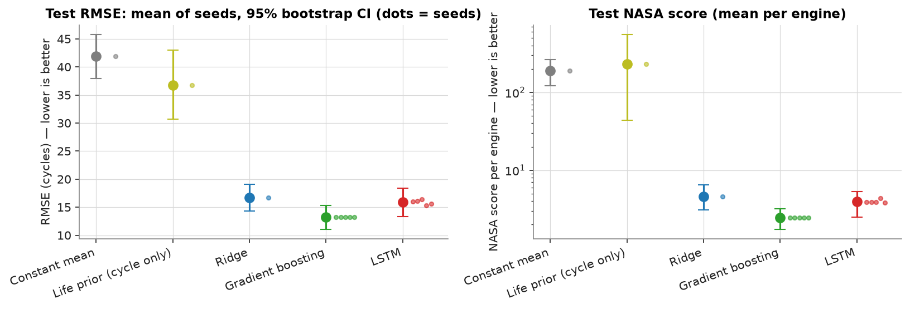
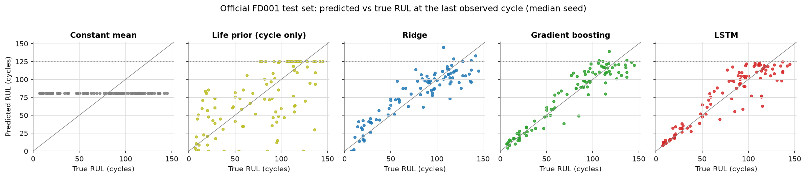

# EngineRUL

Predicting the **remaining useful life (RUL)** of turbofan engines from multivariate sensor histories, on NASA's C-MAPSS FD001 benchmark. The project runs end to end, from verified raw data to a single locked test evaluation: leakage-safe preprocessing, two naive baselines, Ridge, gradient boosting, and a PyTorch LSTM, all compared under one protocol with seed variance and bootstrap confidence intervals.

> [!IMPORTANT]
> All results come from NASA's **simulated** C-MAPSS data. They are **not** validated for real aircraft maintenance or flight-safety decisions.

## Results

<!-- RESULTS:START -->
| Model | Test RMSE ↓ | RMSE 95% CI | Test MAE ↓ | NASA score ↓ | Seeds |
|---|---|---|---|---|---|
| **Constant mean** | 41.88 | [37.9, 45.7] | 36.15 | 18,982 | 1 |
| **Life prior (cycle only)** | 36.76 | [30.7, 43.0] | 28.02 | 23,109 | 1 |
| **Ridge** | 16.74 | [14.3, 19.1] | 13.49 | 459 | 1 |
| **Gradient boosting** | 13.26 | [11.1, 15.3] | 9.86 | 244 | 5 (identical runs) |
| **LSTM** | 15.90 ± 0.42 | [13.3, 18.4] | 11.89 ± 0.46 | 397 ± 23 | 5 |

<sub>Official FD001 test set, 100 engines, uncapped labels; mean ± std over seeds; CI = engine bootstrap of the median seed. Source: `results/final/summary.json` (generated 2026-11-11).</sub>

- Lowest mean test RMSE: **Gradient boosting** (13.26 cycles; seeds: 5 (identical runs); NASA score 244).
- On validation (the selection data), **LSTM** had the lowest RMSE (13.75 vs 14.00 for Gradient boosting); the ranking flipped on the test set, a reminder of how noisy 20 validation engines are.
- LSTM has higher test RMSE than Gradient boosting (median seeds, Δ = +2.74, paired 95% CI [0.38, 5.21]).
- Ridge has lower test RMSE than Life prior (cycle only) (median seeds, Δ = -20.02, paired 95% CI [-25.79, -14.23]).
- Gradient boosting has lower test RMSE than Life prior (cycle only) (median seeds, Δ = -23.50, paired 95% CI [-29.65, -17.29]).
- LSTM has lower test RMSE than Life prior (cycle only) (median seeds, Δ = -20.76, paired 95% CI [-26.76, -14.79]).
- Life prior (cycle only) vs Constant mean: no clear difference on 100 test engines (Δ = -5.12, 95% CI [-12.62, 1.87] includes 0).
<!-- RESULTS:END -->




Full tables (capped-truth variant, degradation-stage breakdown, worst engines, feature importance, benchmarks, sensitivity study, test-set usage log) are in **[`reports/report.md`](reports/report.md)**.

## Validation-only findings (Phase 2)

> [!NOTE]
> Everything in this section comes from cross-validation on the **training** engines. The official test set was not used again, and none of these results changed the Phase-1 models above. CV numbers use capped truth and many truncation points per engine, so they are **not comparable** to the test table.

<!-- PHASE2:START -->
| Model | CV RMSE (fold mean ± sd) | Pooled 95% CI (approx.) | Best in % of folds |
|---|---|---|---|
| **Constant mean** | 41.61 ± 1.60 | [41.15, 42.15] | 0% |
| **Life prior (cycle only)** | 32.67 ± 1.95 | [28.96, 36.53] | 0% |
| **Ridge** | 16.95 ± 0.96 | [16.05, 18.01] | 0% |
| **Gradient boosting** | 13.92 ± 0.97 | [12.88, 15.15] | 87% |
| **LSTM** | 15.13 ± 1.41 | [14.13, 16.27] | 13% |

<sub>3 × 5-fold nested, engine-grouped CV on the 100 training engines; uniform truncation endpoints; truth capped at 125. Source: `results/phase2/cv/`.</sub>

- Gradient boosting − LSTM: Δ RMSE = -1.23, paired engine-bootstrap 95% CI [-2.14, -0.36]; the CI excludes 0.
- Model rankings across uniform / late-life / stage-stratified validation endpoints: Kendall τ = 1.00 for every pair.
- Ablation, Ridge: clearly worse than the full model: `cycle_only` (+13.5), `stats_last` (+4.5), `stats_last_mean` (+3.9); clearly better: none (Δ RMSE, paired CI excludes 0).
- Ablation, Gradient boosting: clearly worse than the full model: `cycle_only` (+15.0), `stats_last` (+5.0), `stats_last_mean` (+5.1); clearly better: none (Δ RMSE, paired CI excludes 0).
- Ablation, LSTM: clearly worse than the full model: `sensors_only` (+1.0), `cycle_only` (+12.8), `window_20` (+1.6); clearly better: `window_40` (-1.1) (Δ RMSE, paired CI excludes 0).
- Ablation improvements are validation-only observations; the frozen Phase-1 models were not changed, and adopting a variant would need a new frozen config and a fresh held-out test.
- 90% split-conformal prediction intervals, empirical coverage on held-out engines: Ridge 89% (mean width 54 cycles), Gradient boosting 91% (mean width 54 cycles), LSTM 94% (mean width 67 cycles).
<!-- PHASE2:END -->

Details, figures and limitations: **[`reports/phase2_report.md`](reports/phase2_report.md)**. Methods and assumptions: [`docs/phase2.md`](docs/phase2.md).

## Problem

Each engine starts healthy, develops a fault, and runs to failure. Given the sensor history up to the current cycle, predict how many cycles remain. Errors are asymmetric: predicting **more** life than remains (a *late* prediction) is the dangerous direction, and the benchmark's NASA score penalizes it more heavily.

## Dataset

| | FD001 |
|---|---|
| Source | NASA PCoE C-MAPSS, via a Hugging Face mirror pinned to revision `4d14a0bf…` (raw `.txt` files only) |
| Training | 100 engines run to failure, 20,631 cycles, lifetimes 128–362 cycles |
| Test | 100 engines truncated before failure, one true RUL label per engine |
| Columns | unit, cycle, 3 operational settings, 21 sensors |
| Used | 14 informative sensors and the current cycle. 7 constant or two-valued sensors and the 3 settings are dropped |

The official NASA download could not be reached during development, so every file is checked against SHA-256 checksums pinned in [`configs/dataset_manifest.yaml`](configs/dataset_manifest.yaml), along with structural invariants (row counts, unit IDs, contiguous cycles, value ranges). `engine-rul data verify --zip CMAPSSData.zip` cross-checks NASA's original archive whenever it is available. Data.gov lists no explicit license and the mirror says `other`, so the data is downloaded at setup and never committed. Details: [`docs/dataset.md`](docs/dataset.md).

Citation: A. Saxena, K. Goebel, D. Simon, N. Eklund, "Damage Propagation Modeling for Aircraft Engine Run-to-Failure Simulation," *PHM08*, Denver, CO, 2008.

## Pipeline


## Models

| Model | Input | Notes |
|---|---|---|
| Constant mean | — | Mean training target; the floor any model must beat |
| Life prior | current cycle only | `mean lifetime − cycle`, capped. Tests whether sensors add anything beyond elapsed time |
| Ridge | 57 window features | last / mean / std / slope of each sensor over the window, plus cycle. α tuned on validation |
| Gradient boosting | 57 window features | scikit-learn `HistGradientBoostingRegressor`, 24-config grid, internal row-level early stopping disabled (it would leak across engines) |
| LSTM (PyTorch) | 30 × 15 sequence | 8-config grid. Adam, MSE on scaled target, gradient clipping, early stopping on validation engines with best-weight restore |

Every model sees the same 30-cycle history at the same evaluation points, is trained on the same 80 engines with the same target, and gets the same post-processing (clip at 0).

## Evaluation protocol

- **Target:** `RUL = last cycle − cycle`, capped at 125 for training (piecewise-linear target).
- **Model selection:** RMSE on 200 test-like validation points (10 seeded truncations of each of the 20 validation engines). The test set is never used for tuning, early stopping, or feature choices.
- **Test:** one prediction per test engine at its last observed cycle, scored against the **official uncapped labels** (headline) and against labels capped at 125 (literature-style, in the report).
- **Metrics:** with error $d = \hat{y} - y$,

  $$\text{RMSE}=\sqrt{\tfrac1N\textstyle\sum d_i^2},\quad \text{MAE}=\tfrac1N\textstyle\sum |d_i|,\quad S=\textstyle\sum_i \begin{cases} e^{-d_i/13}-1 & d_i<0\\ e^{d_i/10}-1 & d_i\ge 0\end{cases}$$

- **Uncertainty:** mean ± std over 5 seeds (deterministic models trained once), a 2000-resample engine bootstrap CI, and paired bootstrap CIs for model differences. A model is called better only when that CI excludes 0.
- **Test-set lock:** `evaluate --split test` refuses to run without `--final`, accepts only frozen `stage=final` runs whose config hash matches `configs/final/`, and appends every evaluation to [`results/test_evaluations.jsonl`](results/test_evaluations.jsonl). This is a procedural safeguard against accidental use (the label file is still on disk), not a security boundary.
- **Leakage tests:** scaler and sensor selection fitted on training engines only, windows that never cross engines, and training/tuning that fail if they touch test files ([`tests/test_leakage.py`](tests/test_leakage.py)).

Published C-MAPSS numbers use different protocols and are not ranked against these results. See [`docs/external_results.md`](docs/external_results.md).

## Reproduce

Requires [uv](https://docs.astral.sh/uv/). Python 3.12 is installed automatically.

```bash
make setup          # uv sync --frozen
make data           # download + verify FD001 (≈6 MB)
make reproduce      # EDA → tune → sensitivity → 5-seed final → test eval → benchmarks → report
make test           # pytest (synthetic + real-data tests)
uv run mlflow ui --backend-store-uri sqlite:///mlflow.db   # browse runs
```

Committed results were produced on CPU (Apple M3 Pro). On that machine, CPU training is bit-for-bit deterministic: the frozen LSTM config retrained during the final stage gave exactly the validation RMSE recorded during tuning. Runs on `--device mps|cuda` work but may differ slightly. Step-by-step commands, configs, and reproducibility notes: [`docs/experiments.md`](docs/experiments.md) and [`docs/testing.md`](docs/testing.md).

## Repository layout

```text
src/engine_rul/   data · split · preprocess · features · models/ · train · evaluate · metrics · benchmark · tracking · plots · report · cli
configs/          base + per-model configs, tuning grids, frozen final configs, dataset manifest
splits/           committed engine-level split
results/final/    machine-readable results (summary, tuning, sensitivity, benchmarks)
reports/          generated report.md and figures
docs/             decisions, dataset, experiments, testing, pipeline, progress, external results
tests/            unit, leakage, reproducibility and end-to-end tests
```

## Limitations

- Simulated data, a single subset (FD001: one operating condition, one fault mode), and only 100 test engines, so confidence intervals are wide.
- One fixed engine split. Final models are not retrained on all 100 training engines.
- Models trained on a target capped at 125 can't predict long RULs exactly. 11 test engines have a true RUL above 125.
- The mirror's files match pinned checksums, but byte-identity with NASA's original archive is unverified.

**Next steps:** repeated engine-level cross-validation, FD002–FD004 with per-condition normalization, and calibrated prediction intervals.

## Built with

Python 3.12 · PyTorch · scikit-learn · pandas · NumPy · Matplotlib · MLflow · pytest · uv · ruff

Code is MIT-licensed ([LICENSE](LICENSE)). The C-MAPSS data is not covered by this license.
