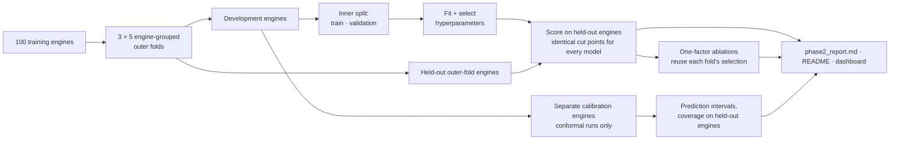
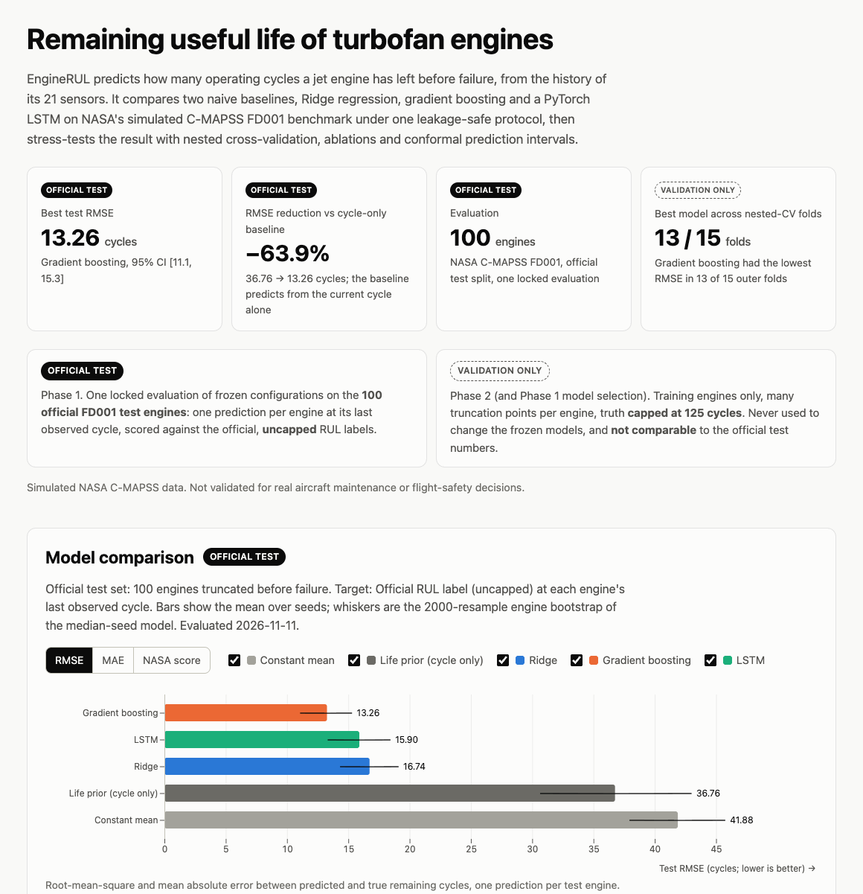

# EngineRUL

Predicting how many cycles a turbofan engine has left before failure, from the history of its sensors. EngineRUL compares two naive baselines, Ridge regression, gradient boosting and a PyTorch LSTM on NASA's C-MAPSS FD001 benchmark under one leakage-safe protocol, evaluates the frozen models **once** on the official test set, and then stress-tests the result with validation-only nested cross-validation, ablations and conformal prediction intervals.

**[Interactive results dashboard](https://eliot-2006.github.io/engine-rul/)** · [Phase 1 report](reports/report.md) · [Phase 2 report](reports/phase2_report.md) · [Methods](docs/phase2.md)

[](https://github.com/Eliot-2006/engine-rul/actions/workflows/ci.yml) Python · PyTorch · scikit-learn · pandas · NumPy · MLflow

> [!IMPORTANT]
> C-MAPSS is **simulated** data. These results are not validated for real aircraft maintenance or flight-safety decisions.

## Results at a glance

<!-- GLANCE:START -->
| Best official test RMSE | vs. cycle-only baseline | Evaluation |
|:---:|:---:|:---:|
| **13.26 cycles**<br><sub>gradient boosting</sub> | **−63.9% RMSE**<br><sub>36.76 → 13.26 cycles</sub> | **100 test engines**<br><sub>NASA C-MAPSS FD001</sub> |

<sub>Official FD001 test split, one prediction per engine at its last observed cycle, scored against the official (uncapped) RUL labels; evaluated once with frozen configurations. RMSE is an error in cycles (lower is better), not an accuracy. Baseline: the *life prior*, which predicts from the current cycle only. Generated from `results/final/summary.json` by `engine-rul readme`.</sub>
<!-- GLANCE:END -->


**Contents:** [Overview](#overview) · [Pipeline](#pipeline) · [Models and official results](#models-and-official-results) · [Validation-only findings](#validation-only-findings-phase-2) · [Quick start](#quick-start) · [Documentation](#documentation) · [Limitations](#limitations)

## Overview

**Remaining useful life (RUL)** is the number of operating cycles an engine has left before it fails. Predicting it lets maintenance be scheduled before a failure instead of on a fixed calendar or after a breakdown.

Each of the 100 FD001 training engines starts healthy, develops a fault and runs to failure while 21 sensors (temperatures, pressures, fan and core speeds) are recorded every cycle. A single reading says little, but wear shows up as slow **trends** across many cycles, so every model here sees the last 30 cycles of an engine's history. The 100 test engines are cut off at an unknown point before failure, and the task is to predict how many cycles each had left.

Errors are asymmetric: predicting **more** life than remains (a *late* prediction) is the dangerous direction, which the benchmark's NASA score penalizes exponentially harder.

## Pipeline

### Phase 1: model development and the locked test evaluation

```mermaid
flowchart LR
  A[Raw FD001 files<br/>SHA-256 verified] --> B[Engine-level split<br/>80 train / 20 validation]
  B --> C[Preprocess<br/>fit on train engines only]
  C --> D[30-cycle windows<br/>+ 57 window statistics]
  D --> E[Baselines · Ridge ·<br/>Gradient boosting · LSTM]
  E --> F[Tune on validation engines<br/>→ frozen configs]
  F --> G[Final training<br/>LSTM: 5 seeds · others: deterministic]
  G --> H{{One logged evaluation<br/>on the official test set}}
  H --> I[results/final → report,<br/>README, dashboard]
```



### Phase 2: validation-only reliability study (training engines only)



The official test files are never read in Phase 2, and nothing in Phase 2 changed the frozen Phase 1 models. Calibration engines are never used for fitting, selection or coverage measurement.

## Models and official results

| Model | Input | Notes |
|---|---|---|
| Constant mean | — | Mean training target: the floor any model must beat |
| Life prior | current cycle only | `mean lifetime − cycle`, capped: do sensors add anything beyond elapsed time? |
| Ridge | 57 window features | last / mean / std / slope of 14 sensors over the window, plus cycle |
| Gradient boosting | 57 window features | scikit-learn `HistGradientBoostingRegressor`, 24-config grid |
| LSTM (PyTorch) | 30 × 15 sequence | 8-config grid, early stopping on validation engines |

All models see the same 30-cycle history at the same evaluation points, are trained on the same 80 engines with a target capped at 125 cycles, and are clipped at 0.

<!-- RESULTS:START -->
| Model | Test RMSE ↓ | RMSE 95% CI | Test MAE ↓ | NASA score ↓ | Seeds |
|---|---|---|---|---|---|
| **Constant mean** | 41.88 | [37.9, 45.7] | 36.15 | 18,982 | 1 |
| **Life prior (cycle only)** | 36.76 | [30.7, 43.0] | 28.02 | 23,109 | 1 |
| **Ridge** | 16.74 | [14.3, 19.1] | 13.49 | 459 | 1 |
| **Gradient boosting** | 13.26 | [11.1, 15.3] | 9.86 | 244 | 5 (identical runs) |
| **LSTM** | 15.90 ± 0.42 | [13.3, 18.4] | 11.89 ± 0.46 | 397 ± 23 | 5 |

<sub>Official FD001 test set, 100 engines, uncapped labels; mean ± std over seeds; CI = engine bootstrap of the median seed. Source: `results/final/summary.json` (generated 2026-11-11).</sub>

- Lowest mean test RMSE: **Gradient boosting** (13.26 cycles; seeds: 5 (identical runs); NASA score 244).
- On validation (the selection data), **LSTM** had the lowest RMSE (13.75 vs 14.00 for Gradient boosting); the ranking flipped on the test set, a reminder of how noisy 20 validation engines are.
- LSTM has higher test RMSE than Gradient boosting (median seeds, Δ = +2.74, paired 95% CI [0.38, 5.21]).
<!-- RESULTS:END -->

**Why gradient boosting beat the LSTM.** These are explanations consistent with the evidence, not controlled experiments:

- **Little data.** 80 training engines give about 14,000 heavily overlapping windows: enough for a shallow tree ensemble, thin for a recurrent network.
- **Explicit trend features.** Gradient boosting gets each sensor's window slope as an input. Removing the slopes costs it about 5 RMSE in the Phase 2 ablations, while the window std adds nothing measurable.
- **Noisy selection.** The LSTM ranked first on the 20 validation engines, but gradient boosting was better on the test set and in 13 of 15 nested-CV folds.

Gradient boosting's five seeds produce bit-identical models, so they are not independent evidence of stability; Ridge and the baselines are deterministic and trained once. The capped-truth variant, degradation-stage breakdown, worst engines, feature importance, sensitivity study and the full test-set usage log are in [`reports/report.md`](reports/report.md).

**Evaluation protocol.** Model selection used RMSE on 200 test-like truncation points of the 20 validation engines; the test set was never used for tuning, early stopping or feature choices. `evaluate --split test` only accepts frozen `stage=final` runs whose config hash matches `configs/final/` and appends every evaluation to [`results/test_evaluations.jsonl`](results/test_evaluations.jsonl) (one round, 13 runs). This lock is a procedural safeguard against accidental use, not a security boundary. Leakage tests check that preprocessing is fit on training engines only, windows never cross engines, and training fails if it touches test files ([`tests/test_leakage.py`](tests/test_leakage.py)). Published C-MAPSS numbers use different protocols and are not ranked against these results ([`docs/external_results.md`](docs/external_results.md)).

## Validation-only findings (Phase 2)

> [!NOTE]
> Training engines only, many truncation cut points per engine, truth capped at 125. These numbers are **not comparable** to the official test table above, and none of them changed the Phase 1 models.

<!-- PHASE2:START -->
| Model | Pooled CV RMSE [approx. 95% CI] | Mean ± sd over 15 folds | Best in folds |
|---|---|---|---|
| **Constant mean** | 41.63 [41.15, 42.15] | 41.61 ± 1.60 | 0 / 15 |
| **Life prior (cycle only)** | 32.72 [28.96, 36.53] | 32.67 ± 1.95 | 0 / 15 |
| **Ridge** | 16.98 [16.05, 18.01] | 16.95 ± 0.96 | 0 / 15 |
| **Gradient boosting** | 13.95 [12.88, 15.15] | 13.92 ± 0.97 | 13 / 15 |
| **LSTM** | 15.19 [14.13, 16.27] | 15.13 ± 1.41 | 2 / 15 |

<sub>3 × 5-fold nested, engine-grouped CV on the 100 training engines; 3000 uniform truncation cut points per model; truth capped at 125. Source: `results/phase2/cv/`.</sub>

- Gradient boosting − LSTM: Δ RMSE = -1.23, paired engine-bootstrap 95% CI [-2.14, -0.36]; the CI excludes 0.
- Model rankings across uniform / late-life / stage-stratified cut points: Kendall τ = 1.00 for every pair.
- Ablations with a clear effect (Δ RMSE vs the full model, paired CI excludes 0): Ridge: `cycle_only` +13.5, `stats_last` +4.5, `stats_last_mean` +3.9; Gradient boosting: `cycle_only` +15.0, `stats_last` +5.0, `stats_last_mean` +5.1; LSTM (1 repeat): `sensors_only` +1.0, `cycle_only` +12.8, `window_20` +1.6, `window_40` -1.1. Validation-only: the frozen Phase-1 models were not changed.
- 90% split-conformal intervals, empirical coverage on held-out engines: Ridge 89% (mean width 54 cycles), Gradient boosting 91% (mean width 54 cycles), LSTM 94% (mean width 67 cycles).
<!-- PHASE2:END -->

Pooled RMSE is computed over all held-out predictions; the fold mean averages the 15 per-fold RMSEs. The CIs are approximate because repeated folds share training engines. The one-cut-point-per-engine conformal method has a finite-sample coverage guarantee under exchangeability; with 20 calibration engines per fold its realised coverage varies widely between folds, and no interval is guaranteed for the official test set's truncation process. Every number above can be explored interactively in the [dashboard](https://eliot-2006.github.io/engine-rul/):

[](https://eliot-2006.github.io/engine-rul/)

## Quick start

Requires [uv](https://docs.astral.sh/uv/) (Python 3.12 is installed automatically) and, for the dashboard only, Node.js ≥ 20.19.

```bash
make setup                 # uv sync --frozen
make data                  # download FD001 (≈6 MB) and verify SHA-256 checksums
make test                  # unit, leakage, reproducibility, dashboard-export and end-to-end tests
make repro-check           # retrain the frozen configs, compare with published validation RMSE
make reports               # reports, README blocks and dashboard data from committed results
make dashboard             # build the static dashboard into dashboard/dist
cd dashboard && npm run dev   # browse it locally
```

| Workflow | Command | Reads official test labels? |
|---|---|---|
| Phase 1 training + validation | `make reproduce-phase1` (~15 min CPU) | No |
| Phase 2 validation experiments | `make phase2` (~1.5 h CPU) | No |
| Reports, README, dashboard data | `make reports` | No (committed artifacts only) |
| All of the above | `make reproduce` | No |
| The original official test evaluation | `make official-test-eval CONFIRM=official-test` | **Yes**: appends a round to the evaluation log |

Published artifacts are never overwritten unless `FORCE=--force` is given. Predict for new sensor files with `uv run engine-rul predict --run <run dir> --input <sensor file>`; models trained in Phase 2's conformal run add calibrated intervals (`--levels 0.8 0.9`). Committed results were produced on CPU (Apple M3 Pro), where training is bit-for-bit deterministic; CI re-runs the fast frozen configs on Linux and matches the published validation RMSE within 1e-3.

## Documentation

| Topic | Where |
|---|---|
| Official test results, stage breakdown, feature importance, benchmarks | [`reports/report.md`](reports/report.md) |
| Phase 2 results, figures and limitations | [`reports/phase2_report.md`](reports/phase2_report.md) |
| Phase 2 methods and assumptions | [`docs/phase2.md`](docs/phase2.md) |
| Dataset, checksums and licensing | [`docs/dataset.md`](docs/dataset.md) |
| Configs, experiment sequence, benchmark method | [`docs/experiments.md`](docs/experiments.md) |
| Reproducibility, provenance and tests | [`docs/testing.md`](docs/testing.md) |
| Module architecture and diagrams | [`docs/pipeline.md`](docs/pipeline.md) |
| Design decisions and post-test changes | [`docs/decisions.md`](docs/decisions.md) |
| Dashboard build and data export | [`dashboard/README.md`](dashboard/README.md) |

## Limitations

- Simulated data and a single subset (FD001: one operating condition, one fault mode). Only 100 test engines, so test confidence intervals are wide.
- Phase 1 uses one fixed engine split, and final models are not retrained on all 100 training engines.
- Models trained on a target capped at 125 cannot predict long RULs exactly; 11 test engines have a true RUL above 125.
- The data comes from a pinned mirror whose files match recorded checksums; byte-identity with NASA's original archive is unverified ([`docs/dataset.md`](docs/dataset.md)).
- Phase 1 ran from an uncommitted working tree (commit `c457958` plus local changes) and no source snapshot was kept for it; its frozen configs are hash-checked and reproduced by `repro-check`. Phase 2 results reference committed source snapshots ([`docs/testing.md`](docs/testing.md)).

**Next steps:** FD002–FD004 with per-condition normalization, retraining final models on all training engines, and a fresh held-out evaluation for any variant adopted from the ablations.

Data citation: A. Saxena, K. Goebel, D. Simon, N. Eklund, "Damage Propagation Modeling for Aircraft Engine Run-to-Failure Simulation," *PHM08*, Denver, CO, 2008. Code is MIT-licensed ([LICENSE](LICENSE)); the C-MAPSS data is not covered by this license and is downloaded at setup, never committed.
