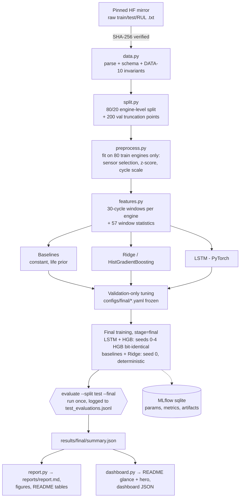
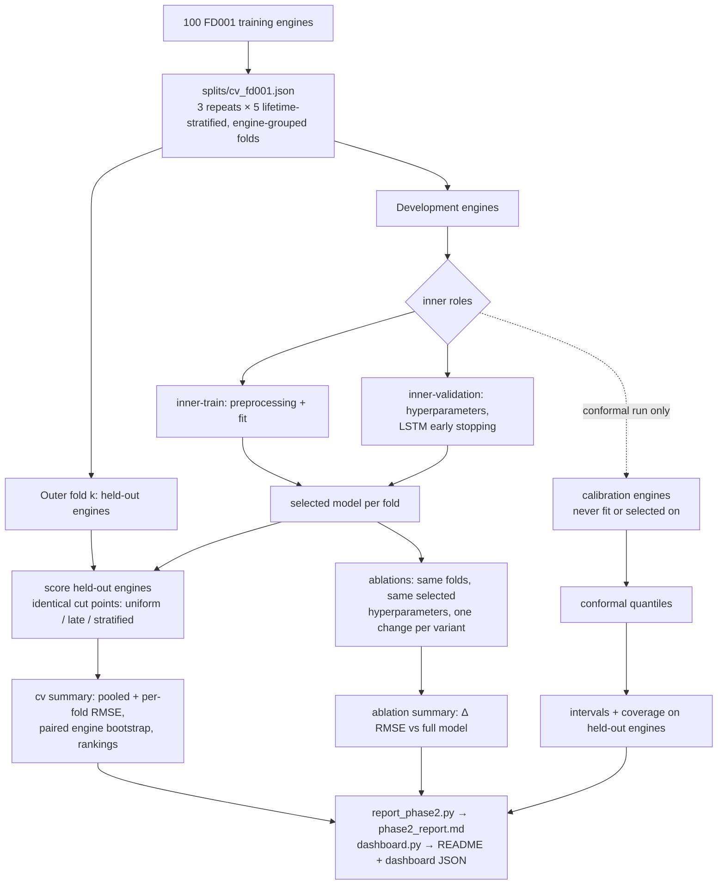

# Pipeline and module architecture

## Phase 1: end-to-end pipeline and the locked test evaluation



`make official-test-eval CONFIRM=official-test` is the only workflow that runs step I; `make reproduce` stops at H.

## Phase 2: validation-only experiments (training engines only)



Calibration engines are disjoint from the inner-train, inner-validation and held-out engines of
the same fold (`tests/test_phase2.py`). No Phase-2 step reads the official test files.

## Module responsibilities

| Module | Owns | Must not |
|---|---|---|
| `data.py` | download, checksum, parse, schema, RUL labels, `load_test_rul` | normalize or select features |
| `split.py` | engine-level split + validation truncation points | read test files |
| `preprocess.py` | `Preprocessor` (fit on train-split rows only) | see validation/test rows at fit time |
| `features.py` | `WindowSet`, windows, tabular stats from `X_seq` only | use targets to build features |
| `models/` | five families behind one fit/predict/save/load protocol | clip predictions or load data |
| `train.py` | single runs, tuning, sensitivity, final seeds | import test loaders |
| `evaluate.py` | validation re-evaluation, locked test evaluation, summary | change models |
| `metrics.py` | RMSE, MAE, NASA score, bootstrap, stage bins | depend on project modules |
| `tracking.py` | MLflow + `run.json` (JSON is the source of truth) | fail a run because MLflow failed |
| `benchmark.py` | latency, throughput, size | read test labels |
| `plots.py`, `eda.py`, `report.py` | figures and reports from saved results | recompute metrics |
| `cv.py` (Phase 2) | CV folds, nested roles, endpoint strategies, per-fold preparation, CV/ablation runners and engine-level analysis | read test files |
| `conformal.py` (Phase 2) | split-conformal calibration, intervals, coverage analysis | touch fitting/selection data |
| `inference.py` | `Predictor` / `predict_engines`: raw sensor rows → predictions (+ intervals if calibrated) | change point predictions |
| `provenance.py` | git/dirty/source snapshot, experiment directories, overwrite protection | — |
| `report_phase2.py` | `reports/phase2_report.md` from `results/phase2/` | recompute model predictions (except the interval figure) |
| `dashboard.py` (Phase 3) | validated dashboard JSON (one file per evaluation protocol), README result blocks, hero figure | train, read raw data or mix protocols in one file |
| `dashboard/` (Phase 3) | static Vite + TypeScript + Observable Plot site; loads the exported JSON and checks each file's `protocol` | compute statistics |

## LSTM architecture

```mermaid
flowchart LR
  X["window [B, 30, 15]<br/>14 z-scored sensors + cycle_norm"] --> L1[LSTM layer(s)<br/>hidden H]
  L1 --> Hn["last time step [B, H]"]
  Hn --> D1["Linear H→H/2 + ReLU + Dropout"]
  D1 --> O["Linear H/2→1"]
  O --> Y["× R_max → RUL (cycles)"]
```
