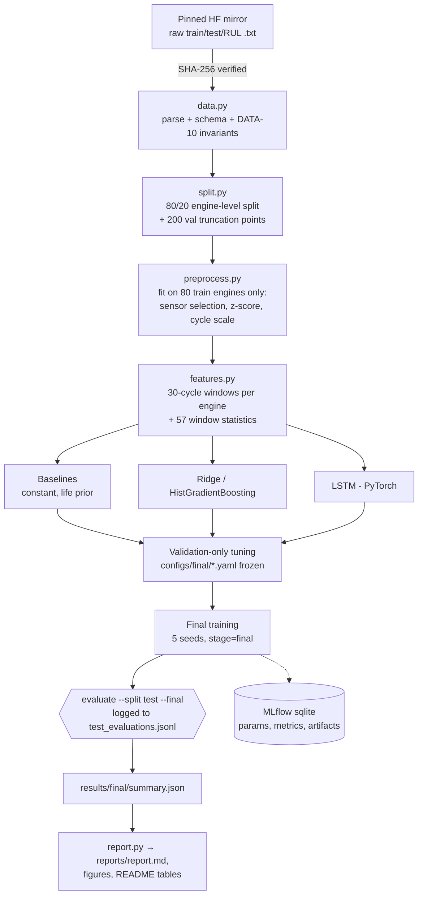

# Pipeline and module architecture

## End-to-end ML pipeline



## Module responsibilities

| Module | Owns | Must not |
|---|---|---|
| `data.py` | download, checksum, parse, schema, RUL labels, `load_test_rul` | normalize or select features |
| `split.py` | engine-level split + validation truncation points | read test files |
| `preprocess.py` | `Preprocessor` (fit on train-split rows only) | see validation/test rows at fit time |
| `features.py` | `WindowSet`, windows, tabular stats from `X_seq` only | use targets to build features |
| `models/` | five families behind one fit/predict/save/load protocol | clip predictions or load data |
| `train.py` | single runs, tuning, sensitivity, final seeds | import test loaders |
| `evaluate.py` | validation re-evaluation, locked test evaluation, summary | change models |
| `metrics.py` | RMSE, MAE, NASA score, bootstrap, stage bins | depend on project modules |
| `tracking.py` | MLflow + `run.json` (JSON is the source of truth) | fail a run because MLflow failed |
| `benchmark.py` | latency, throughput, size | read test labels |
| `plots.py`, `eda.py`, `report.py` | figures and reports from saved results | recompute metrics |

## LSTM architecture

```mermaid
flowchart LR
  X["window [B, 30, 15]<br/>14 z-scored sensors + cycle_norm"] --> L1[LSTM layer(s)<br/>hidden H]
  L1 --> Hn["last time step [B, H]"]
  Hn --> D1["Linear H→H/2 + ReLU + Dropout"]
  D1 --> O["Linear H/2→1"]
  O --> Y["× R_max → RUL (cycles)"]
```
