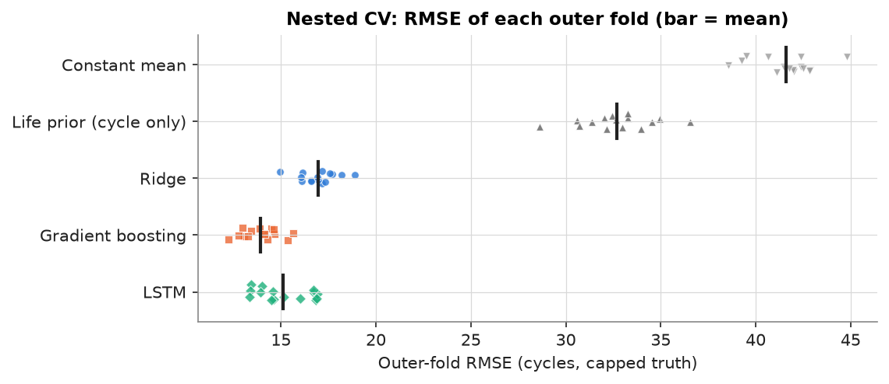
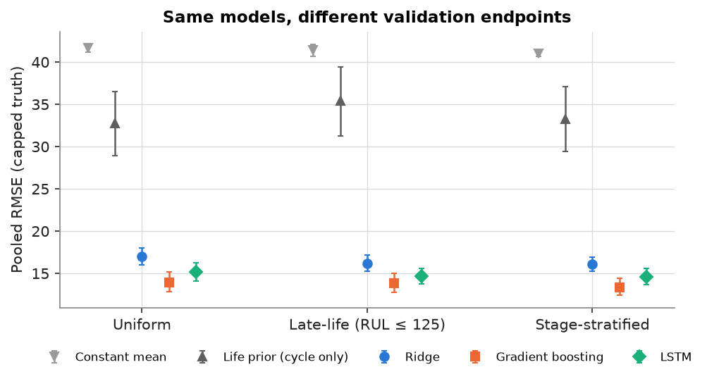
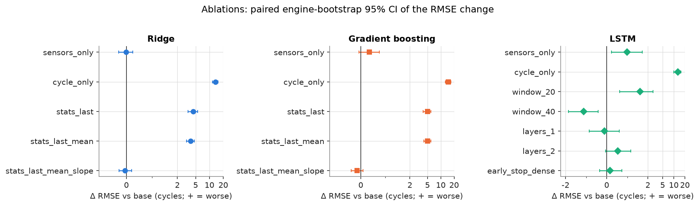
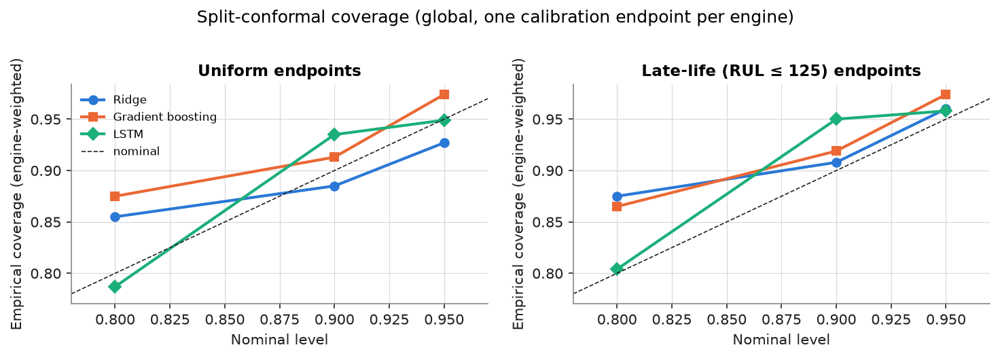
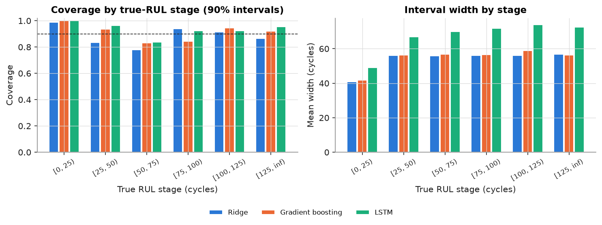
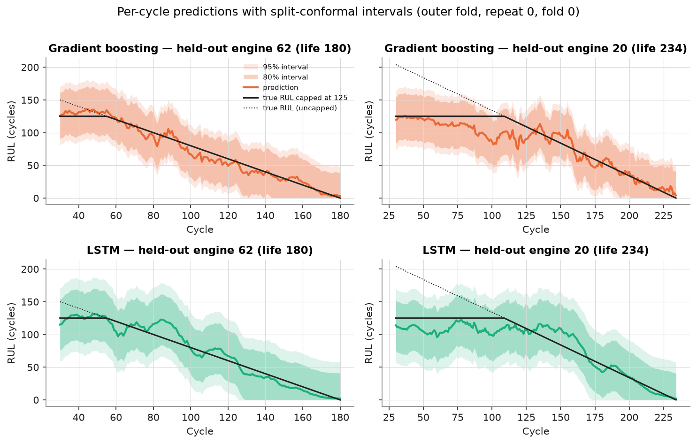
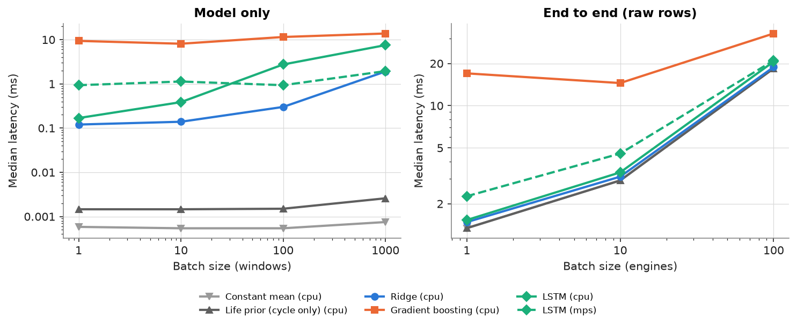

# EngineRUL — Phase 2: validation-only evaluation and reliability

> **Everything in this report uses FD001 *training* engines only.** The official FD001 test set was evaluated once, in Phase 1, with the frozen configurations; those results, the frozen configs and the test-evaluation log are unchanged and are reported only in [`report.md`](report.md). No Phase-2 experiment read the official test files, and nothing here was used to change the Phase-1 models. The numbers below are therefore **not comparable** to published FD001 test scores: they use capped truth and many truncation points per engine.

Generated by `engine-rul report-phase2` from `results/phase2/`. Method details and assumptions: [`docs/phase2.md`](../docs/phase2.md).

## Key findings

* Under nested, repeated, engine-grouped CV, **Gradient boosting** has the lowest RMSE (13.95 cycles, capped truth) and is best in 13 of 15 outer folds.
* Ridge vs Gradient boosting: Δ RMSE +3.02, paired 95% CI [2.20, 3.92] — Ridge is higher.
* Ridge vs LSTM: Δ RMSE +1.79, paired 95% CI [1.02, 2.59] — Ridge is higher.
* Gradient boosting vs LSTM: Δ RMSE -1.23, paired 95% CI [-2.14, -0.36] — Gradient boosting is lower.
* Phase 1's single 20-engine validation split ranked LSTM first (13.75 vs 14.00 for Gradient boosting); with every engine held out and selection nested, that ordering does not hold. A single small validation split was not enough to rank these models. (Phase-1 test results were not used for this or any Phase-2 analysis.)
* Model *rankings* do not depend on the endpoint strategy (Kendall τ = 1.00 for every pair), but the *selected hyperparameters* do: another strategy would have picked the same config in only 20%–40% of outer folds, so validation-error landscapes are flat relative to fold noise.
* Engine-bootstrap rank-1 shares are much more confident than fold rank-1 shares because the bootstrap ignores training-set variability; read the fold spread as the more honest stability measure.

## 1. Protocol

* **Outer loop:** 3 repeats × 5-fold engine-grouped CV (`splits/cv_fd001.json`, sha256 `a38a58d1a1d3`); folds are lifetime-stratified, each of the 100 training engines is held out exactly once per repeat.
* **Inner loop (nested):** each outer fold's development engines are split train 80% / val 20% by engine. Preprocessing (sensor selection, z-scoring) is fit on inner-train engines only; hyperparameters are re-selected per outer fold from the Phase-1 grids on inner-validation endpoints; LSTM early stopping uses the same inner-validation endpoints (`early_stopping: endpoints`). The outer engines influence nothing but the score.
* **Endpoints:** 10 truncation cycles per engine (cycle ≥ 40), drawn with a fixed seed per (strategy, engine); every model and variant is scored on identical endpoints. Selection uses `uniform` endpoints; other strategies are scored, never selected on.
* **Truth:** RUL capped at 125 (the training target) unless stated as uncapped.
* **Statistics at the engine level:** per-engine mean errors first, then engines are averaged with equal weight; confidence intervals resample engines (cluster bootstrap, 2000 resamples). Windows and endpoints are never treated as independent samples. Because CV training sets overlap, these CIs ignore training-set variability and are **approximate (likely somewhat narrow)**.
* Provenance: commit `b618515d7c` (working tree dirty, source snapshot `results/snapshots/655f5c3452695fe7.tar.gz`); spec `configs/phase2/cv.yaml` sha256 `857ea924a1c3`.

## 2. Cross-validation results

| Model | RMSE | 95% CI† | Fold RMSE mean ± sd (range) | MAE | NASA / point | Bias | RMSE (uncapped truth) | Mean fold RMSE per repeat |
|---|---|---|---|---|---|---|---|---|
| **Constant mean** | 41.63 | [41.15, 42.15] | 41.61 ± 1.60 (38.6–44.8) | 36.33 | 227.46 | 5.83 | 55.16 | 42.34 / 41.13 / 41.35 |
| **Life prior (cycle only)** | 32.72 | [28.96, 36.53] | 32.67 ± 1.95 (28.6–36.6) | 23.46 | 127.98 | 5.36 | 42.67 | 32.63 / 33.21 / 32.17 |
| **Ridge** | 16.98 | [16.05, 18.01] | 16.95 ± 0.96 (15.0–18.9) | 13.80 | 5.24 | 3.44 | 31.95 | 17.06 / 17.27 / 16.53 |
| **Gradient boosting** | 13.95 | [12.88, 15.15] | 13.92 ± 0.97 (12.2–15.6) | 10.07 | 3.93 | 1.89 | 29.93 | 13.85 / 14.31 / 13.60 |
| **LSTM** | 15.19 | [14.13, 16.27] | 15.13 ± 1.41 (13.3–16.9) | 11.11 | 4.64 | 0.22 | 31.05 | 15.70 / 15.32 / 14.36 |

3000 held-out endpoints per model in total (3 repeats × 100 engines × 10; 15 outer folds). † engine cluster bootstrap over pooled predictions (approximate).

**Hyperparameters selected inside the outer folds** (how often each config won the inner validation):

* Ridge: `{"alpha": 100.0}` × 5; `{"alpha": 1000.0}` × 5; `{"alpha": 31.6228}` × 2; `{"alpha": 3.1623}` × 1; 2 other configs
* Gradient boosting: `{"l2_regularization": 0.0, "learning_rate": 0.1, "max_iter": 200, "max_leaf_nodes": 15, "min_samples_leaf": 100}` × 2; `{"l2_regularization": 0.0, "learning_rate": 0.03, "max_iter": 200, "max_leaf_nodes": 31, "min_samples_leaf": 20}` × 2; `{"l2_regularization": 0.0, "learning_rate": 0.03, "max_iter": 200, "max_leaf_nodes": 7, "min_samples_leaf": 100}` × 2; `{"l2_regularization": 0.0, "learning_rate": 0.1, "max_iter": 200, "max_leaf_nodes": 7, "min_samples_leaf": 20}` × 1; 8 other configs
* LSTM: `{"dropout": 0.1, "hidden_size": 64, "num_layers": 1}` × 4; `{"dropout": 0.3, "hidden_size": 64, "num_layers": 1}` × 4; `{"dropout": 0.1, "hidden_size": 32, "num_layers": 1}` × 2; `{"dropout": 0.1, "hidden_size": 64, "num_layers": 2}` × 1; 4 other configs

## 3. Ranking stability and paired comparisons

| Model | Pooled rank | Mean rank over outer folds | Rank-1 share (folds) | Rank-1 share (engine bootstrap) |
|---|---|---|---|---|
| Constant mean | 5 | 5.00 | 0% | 0% |
| Life prior (cycle only) | 4 | 4.00 | 0% | 0% |
| Ridge | 3 | 2.93 | 0% | 0% |
| Gradient boosting | 1 | 1.13 | 87% | >99% |
| LSTM | 2 | 1.93 | 13% | <1% |

Paired comparisons on the same held-out engines and endpoints (Δ = RMSE(a) − RMSE(b), capped truth, engine cluster bootstrap):

| a | b | Δ RMSE | 95% CI | CI excludes 0 |
|---|---|---|---|---|
| Ridge | Gradient boosting | +3.02 | [2.20, 3.92] | yes |
| Ridge | LSTM | +1.79 | [1.02, 2.59] | yes |
| Gradient boosting | LSTM | -1.23 | [-2.14, -0.36] | yes |

## 4. Validation strategy comparison

| Strategy | What it measures | Trade-off |
|---|---|---|
| Uniform | average accuracy over an engine's observable life (cycle ≥ min) | dominated by early/mid life where truth is capped and errors are small |
| Late-life | accuracy when RUL ≤ 125, i.e. where maintenance decisions happen | ignores the plateau; fewer distinct cycles per engine |
| Stage-stratified | equal attention to each 25-cycle RUL stage | weights rare very-late stages up; the mix is a design choice |

| Model | Uniform | Late-life (RUL ≤ 125) | Stage-stratified |
|---|---|---|---|
| Constant mean | 41.63 (#5) | 41.39 (#5) | 41.05 (#5) |
| Life prior (cycle only) | 32.72 (#4) | 35.41 (#4) | 33.27 (#4) |
| Ridge | 16.98 (#3) | 16.20 (#3) | 16.07 (#3) |
| Gradient boosting | 13.95 (#1) | 13.84 (#1) | 13.37 (#1) |
| LSTM | 15.19 (#2) | 14.71 (#2) | 14.63 (#2) |

Pooled RMSE (capped truth) and rank, same outer-fold models scored on each endpoint set.

Rank agreement between strategies (Kendall τ over the 5 models): Uniform vs Late-life (RUL ≤ 125) τ = 1.00; Uniform vs Stage-stratified τ = 1.00; Late-life (RUL ≤ 125) vs Stage-stratified τ = 1.00.

If the inner-validation endpoints had used another strategy, the selected hyperparameters would have been the same in this share of outer folds: Late-life (RUL ≤ 125): Ridge 33%, Gradient boosting 20%, LSTM 27%; Stage-stratified: Ridge 40%, Gradient boosting 20%, LSTM 40%.

Paired comparisons on **late-life** endpoints: Ridge − Gradient boosting = +2.36 [1.43, 3.29]; Ridge − LSTM = +1.49 [0.63, 2.42]; Gradient boosting − LSTM = -0.87 [-1.64, -0.11].

## 5. Ablations

Each variant reuses the hyperparameters selected on inner validation for that (repeat, fold, model) in the CV run, the same inner roles and the same held-out endpoints (uniform, capped truth), and changes one thing. Tabular models: 3 repeats; LSTM: repeat 0 (5 outer folds). Δ is paired on engines.

Determinism check — recomputed `base` vs the CV run's predictions, max |difference|: Gradient boosting 0, LSTM 0, Ridge 0.

**Ridge**

| Variant | RMSE | Δ vs base | 95% CI | CI excludes 0 | Fold RMSE mean ± sd |
|---|---|---|---|---|---|
| base | 16.98 | +0.00 | [0.00, 0.00] | – | 16.95 ± 0.96 |
| sensors_only | 16.96 | -0.02 | [-0.30, 0.24] | no | 16.93 ± 1.05 |
| cycle_only | 30.51 | +13.54 | [11.75, 15.39] | yes | 30.49 ± 1.38 |
| stats_last | 21.45 | +4.47 | [3.43, 5.49] | yes | 21.42 ± 1.12 |
| stats_last_mean | 20.88 | +3.90 | [3.15, 4.66] | yes | 20.86 ± 1.04 |
| stats_last_mean_slope | 16.93 | -0.05 | [-0.28, 0.21] | no | 16.91 ± 0.83 |

**Gradient boosting**

| Variant | RMSE | Δ vs base | 95% CI | CI excludes 0 | Fold RMSE mean ± sd |
|---|---|---|---|---|---|
| base | 13.95 | +0.00 | [0.00, 0.00] | – | 13.92 ± 0.97 |
| sensors_only | 14.31 | +0.36 | [-0.07, 0.76] | no | 14.28 ± 1.01 |
| cycle_only | 28.91 | +14.96 | [12.78, 17.06] | yes | 28.87 ± 1.51 |
| stats_last | 18.94 | +4.98 | [3.97, 6.01] | yes | 18.90 ± 1.17 |
| stats_last_mean | 19.03 | +5.07 | [4.13, 5.98] | yes | 18.99 ± 1.22 |
| stats_last_mean_slope | 13.81 | -0.15 | [-0.39, 0.10] | no | 13.77 ± 1.06 |

**LSTM**

| Variant | RMSE | Δ vs base | 95% CI | CI excludes 0 | Fold RMSE mean ± sd |
|---|---|---|---|---|---|
| base | 15.76 | +0.00 | [0.00, 0.00] | – | 15.70 ± 1.60 |
| sensors_only | 16.75 | +0.99 | [0.23, 1.73] | yes | 16.73 ± 0.78 |
| cycle_only | 28.54 | +12.78 | [10.08, 15.43] | yes | 28.53 ± 0.94 |
| window_20 | 17.39 | +1.62 | [0.63, 2.74] | yes | 17.35 ± 1.21 |
| window_40 | 14.65 | -1.11 | [-1.86, -0.42] | yes | 14.55 ± 1.92 |
| layers_1 | 15.66 | -0.10 | [-0.85, 0.61] | no | 15.62 ± 1.27 |
| layers_2 | 16.30 | +0.54 | [-0.06, 1.17] | no | 16.20 ± 2.00 |
| early_stop_dense | 15.93 | +0.17 | [-0.34, 0.73] | no | 15.91 ± 0.95 |

Variant definitions: `sensors_only` drops the normalized-cycle channel; `cycle_only` keeps only it (tabular: its value at the end cycle); `stats_*` restrict the per-sensor window statistics (default last, mean, std, slope); `window_20/40` change the LSTM sequence length (default 30); `layers_1/2` fix the LSTM depth; `early_stop_dense` stops on dense inner-validation windows instead of the selection endpoints. Provenance: commit `b618515d7c` (working tree dirty, source snapshot `results/snapshots/82a4446222b12059.tar.gz`); spec `configs/phase2/ablation.yaml` sha256 `72ab71815829`.

## 6. Prediction intervals (split conformal)

Repeat 0 of the same outer folds. Development engines split train 60% / val 15% / cal 25% by engine: models are fit on inner-train, selected/early-stopped on inner-validation, and **calibrated on engines used for nothing else**; coverage is measured on the outer engines. Score = |capped truth − prediction|; interval = prediction ± q, lower end clipped at 0.

**Uniform held-out endpoints** — coverage (fold range) / mean width in cycles:

| Model | Method | 80% | 90% | 95% |
|---|---|---|---|---|
| Ridge | Global, pooled endpoints | 0.814 (0.70–0.85) / 44.7 | 0.896 (0.84–0.93) / 53.9 | 0.946 (0.94–0.95) / 61.6 |
| Ridge | Global, one endpoint per engine | 0.855 (0.74–0.94) / 50.1 | 0.885 (0.76–0.94) / 53.6 | 0.927 (0.83–0.96) / 60.7 |
| Ridge | Mondrian by predicted RUL | 0.803 (0.77–0.86) / 42.7 | 0.908 (0.88–0.95) / 50.9 | 0.954 (0.92–0.98) / 58.2 |
| Gradient boosting | Global, pooled endpoints | 0.822 (0.80–0.85) / 34.6 | 0.901 (0.89–0.92) / 49.7 | 0.954 (0.94–0.96) / 61.0 |
| Gradient boosting | Global, one endpoint per engine | 0.875 (0.80–0.97) / 44.8 | 0.913 (0.82–0.97) / 54.2 | 0.974 (0.94–0.99) / 68.1 |
| Gradient boosting | Mondrian by predicted RUL | 0.820 (0.77–0.86) / 35.3 | 0.914 (0.89–0.94) / 47.0 | 0.957 (0.94–0.98) / 56.3 |
| LSTM | Global, pooled endpoints | 0.813 (0.78–0.86) / 39.9 | 0.911 (0.88–0.94) / 55.2 | 0.955 (0.94–0.98) / 67.7 |
| LSTM | Global, one endpoint per engine | 0.787 (0.52–0.97) / 44.1 | 0.935 (0.91–0.99) / 67.3 | 0.949 (0.91–0.99) / 70.0 |
| LSTM | Mondrian by predicted RUL | 0.813 (0.74–0.89) / 39.7 | 0.903 (0.85–0.94) / 52.1 | 0.939 (0.89–0.96) / 62.4 |

**Late-life (RUL ≤ 125) held-out endpoints** — coverage (fold range) / mean width in cycles:

| Model | Method | 80% | 90% | 95% |
|---|---|---|---|---|
| Ridge | Global, pooled endpoints | 0.836 (0.76–0.89) / 44.3 | 0.917 (0.87–0.96) / 53.3 | 0.970 (0.96–0.98) / 60.9 |
| Ridge | Global, one endpoint per engine | 0.875 (0.80–0.97) / 49.6 | 0.908 (0.83–0.98) / 53.0 | 0.960 (0.90–0.99) / 60.0 |
| Ridge | Mondrian by predicted RUL | 0.810 (0.71–0.88) / 42.4 | 0.918 (0.91–0.93) / 50.7 | 0.965 (0.96–0.97) / 57.7 |
| Gradient boosting | Global, pooled endpoints | 0.808 (0.73–0.84) / 34.4 | 0.913 (0.88–0.94) / 49.2 | 0.964 (0.94–0.98) / 60.2 |
| Gradient boosting | Global, one endpoint per engine | 0.865 (0.76–0.97) / 44.5 | 0.919 (0.83–0.99) / 53.6 | 0.974 (0.95–0.99) / 67.1 |
| Gradient boosting | Mondrian by predicted RUL | 0.809 (0.76–0.83) / 34.2 | 0.901 (0.88–0.92) / 44.9 | 0.954 (0.94–0.99) / 52.8 |
| LSTM | Global, pooled endpoints | 0.822 (0.79–0.88) / 39.6 | 0.920 (0.89–0.94) / 54.5 | 0.961 (0.94–0.98) / 66.6 |
| LSTM | Global, one endpoint per engine | 0.804 (0.59–0.96) / 43.7 | 0.950 (0.92–1.00) / 66.1 | 0.958 (0.92–1.00) / 68.7 |
| LSTM | Mondrian by predicted RUL | 0.804 (0.73–0.87) / 37.0 | 0.883 (0.86–0.93) / 48.0 | 0.939 (0.92–0.95) / 57.5 |

| Stage (true RUL) | Ridge | Gradient boosting | LSTM |
|---|---|---|---|
| [0, 25) | 0.99 | 1.00 | 1.00 |
| [25, 50) | 0.83 | 0.94 | 0.96 |
| [50, 75) | 0.78 | 0.83 | 0.84 |
| [75, 100) | 0.94 | 0.84 | 0.92 |
| [100, 125) | 0.91 | 0.95 | 0.92 |
| [125, inf) | 0.87 | 0.92 | 0.95 |

Coverage of 90% intervals by true-RUL stage (global, one endpoint per calibration engine).

**How to read this.** `global_one_per_engine` is the only variant with a finite-sample guarantee: it uses one randomly drawn endpoint per calibration engine, so if engines are exchangeable and a new engine is cut at a point drawn the same way, its interval covers the (capped) truth with probability ≥ the nominal level — *marginally*, averaged over engines and cut points. The pooled variants use all endpoints of an engine, which are dependent, so they have no exact guarantee and are judged empirically. No variant promises coverage for a *particular* stage or for differently drawn cut points (the late-life rows), and none applies to the official test set, whose truncation process differs. Coverage is reported against capped truth; against uncapped truth it is lower early in life by construction. The guarantee is also averaged over the random calibration set: with only 20 calibration scores the realised coverage of any one calibrated model varies a lot (see the fold ranges above), which is the price of the exact-guarantee variant on a 100-engine dataset.

**Performance uncertainty vs prediction uncertainty.** The confidence intervals in §2–5 describe how well we know a model's *average* error (e.g. RMSE ± a few cycles, shrinking with more engines). A prediction interval describes where *one engine's* RUL is likely to lie (tens of cycles wide, and it does not shrink with more data, only with a better model).

## 7. Computational benchmarks

* **Model inference:** model.predict on already-built windows (sequence tensor / tabular features computed inside predict for Ridge and HGB); excludes I/O, preprocessing and window construction.
* **End-to-end:** Predictor.predict on raw sensor rows: z-score preprocessing, window construction, feature extraction, prediction, clipping and the output DataFrame; excludes file parsing and model loading (Predictor is constructed once).
* Memory: python_peak_alloc_mb is tracemalloc (Python allocations, incl. NumPy buffers; excludes PyTorch's native allocator); process_max_rss_mb is the whole process peak; process peak RSS 635 MB.
* Phase-1 median-seed models; inputs are training-file sensor rows. Apple M3 Pro (Darwin 27.0.0), torch 2.15.0, scikit-learn 1.9.1; 5 warm-up calls, 20–50 timed repetitions, device synchronisation after every call.

Model-only rows for the two baselines are omitted (they are a few arithmetic operations). Their end-to-end rows are kept: they measure the **pipeline overhead alone** (preprocessing, windowing, output frame), which dominates end-to-end latency for every model except gradient boosting.

| Model | Device | Scope | Batch | Median ms | p95 ms | Throughput / s | Py peak MB |
|---|---|---|---|---|---|---|---|
| Constant mean | cpu | end_to_end | 1 engines | 1.34 | 1.36 | 749 | 0.1 |
| Constant mean | cpu | end_to_end | 10 engines | 2.94 | 2.99 | 3,404 | 0.5 |
| Constant mean | cpu | end_to_end | 100 engines | 18.4 | 36.5 | 5,424 | 4.6 |
| Life prior (cycle only) | cpu | end_to_end | 1 engines | 1.34 | 1.36 | 746 | 0.1 |
| Life prior (cycle only) | cpu | end_to_end | 10 engines | 2.93 | 2.95 | 3,419 | 0.5 |
| Life prior (cycle only) | cpu | end_to_end | 100 engines | 18.4 | 35.8 | 5,427 | 4.6 |
| Ridge | cpu | model | 1 windows | 0.12 | 0.128 | 8,312 | 0.0 |
| Ridge | cpu | model | 10 windows | 0.139 | 0.151 | 71,899 | 0.1 |
| Ridge | cpu | model | 100 windows | 0.301 | 0.327 | 332,249 | 0.7 |
| Ridge | cpu | model | 1000 windows | 1.9 | 1.97 | 525,273 | 6.8 |
| Ridge | cpu | end_to_end | 1 engines | 1.48 | 1.5 | 676 | 0.1 |
| Ridge | cpu | end_to_end | 10 engines | 3.12 | 3.21 | 3,207 | 0.5 |
| Ridge | cpu | end_to_end | 100 engines | 18.8 | 36.4 | 5,307 | 4.6 |
| Gradient boosting | cpu | model | 1 windows | 9.38 | 16.7 | 107 | 0.0 |
| Gradient boosting | cpu | model | 10 windows | 8.09 | 17.8 | 1,236 | 0.1 |
| Gradient boosting | cpu | model | 100 windows | 11.5 | 18.8 | 8,702 | 0.7 |
| Gradient boosting | cpu | model | 1000 windows | 13.8 | 17.7 | 72,563 | 6.8 |
| Gradient boosting | cpu | end_to_end | 1 engines | 17 | 28.9 | 59 | 0.1 |
| Gradient boosting | cpu | end_to_end | 10 engines | 14.5 | 21.2 | 690 | 0.5 |
| Gradient boosting | cpu | end_to_end | 100 engines | 32.7 | 60.8 | 3,057 | 4.6 |
| LSTM | cpu | model | 1 windows | 0.169 | 0.171 | 5,927 | 0.0 |
| LSTM | cpu | model | 10 windows | 0.386 | 0.435 | 25,882 | 0.0 |
| LSTM | cpu | model | 100 windows | 2.75 | 2.97 | 36,414 | 0.0 |
| LSTM | cpu | model | 1000 windows | 7.52 | 7.68 | 133,020 | 0.0 |
| LSTM | cpu | end_to_end | 1 engines | 1.53 | 1.57 | 654 | 0.1 |
| LSTM | cpu | end_to_end | 10 engines | 3.34 | 3.54 | 2,990 | 0.5 |
| LSTM | cpu | end_to_end | 100 engines | 20.6 | 38.2 | 4,852 | 4.6 |
| LSTM | mps | model | 1 windows | 0.934 | 1.07 | 1,071 | 0.0 |
| LSTM | mps | model | 10 windows | 1.13 | 1.77 | 8,841 | 0.0 |
| LSTM | mps | model | 100 windows | 0.934 | 0.991 | 107,074 | 0.0 |
| LSTM | mps | model | 1000 windows | 1.95 | 2.03 | 514,139 | 0.0 |
| LSTM | mps | end_to_end | 1 engines | 2.26 | 2.58 | 442 | 0.1 |
| LSTM | mps | end_to_end | 10 engines | 4.56 | 4.72 | 2,194 | 0.5 |
| LSTM | mps | end_to_end | 100 engines | 21 | 39 | 4,762 | 4.6 |

## 8. Reproducibility

`engine-rul repro-check` retrained the frozen configurations into an isolated directory and compared validation RMSE with `results/final/summary.json` (tolerance 1e-06):

| Model | Seed | Published | Reproduced | |Δ| | Config hash match | OK |
|---|---|---|---|---|---|---|
| Constant mean | 0 | 40.439904 | 40.439904 | 0.0e+00 | True | ✅ |
| Life prior (cycle only) | 0 | 30.929215 | 30.929215 | 0.0e+00 | True | ✅ |
| Ridge | 0 | 15.884493 | 15.884493 | 0.0e+00 | True | ✅ |
| Gradient boosting | 0 | 13.996560 | 13.996560 | 0.0e+00 | True | ✅ |
| LSTM | 0 | 13.582891 | 13.582891 | 0.0e+00 | True | ✅ |

Every Phase-2 experiment directory has a `manifest.json` with the git commit, dirty flag and (when dirty) a content-addressed source snapshot, the spec and its hash, fold-file and data checksums, library versions and device. Experiment directories are never overwritten without `--force`.

## 9. Limitations

* FD001 only (one operating condition, one fault mode, 100 training engines); 20 engines per outer fold.
* Engine bootstrap CIs on pooled CV predictions ignore the dependence created by overlapping training sets and by hyperparameter selection noise; they are approximate. Fold-to-fold spread is shown alongside.
* All CV numbers use capped truth and several endpoints per engine; they are not comparable to the official last-cycle test metric, and none of them was used to revisit Phase-1 choices.
* LSTM ablations use one repeat; LSTM training is seeded and deterministic on CPU in this environment, but seed-to-seed variation is not separated from fold variation.
* Conformal guarantees are marginal and rest on engine exchangeability and on how cut points are drawn; simulated C-MAPSS engines say nothing about real aircraft maintenance.
