# EngineRUL — Experiment Report (FD001)

> Generated by `engine-rul report` from `results/final/*.json`. Do not edit by hand.
>
> All numbers are measured on NASA's **simulated** C-MAPSS data and are not validated for real-world maintenance or flight-safety decisions.

- Results generated: 2026-11-11T03:38:49+00:00 · git `c457958cb9` (uncommitted working-tree changes at evaluation time) · training data SHA-256 `963b5e22825b…` · split SHA-256 `669342b82f31…`
- Hardware: Apple M3 Pro · 18.0 GB RAM · Darwin 27.0.0 · Python 3.12.13 · torch 2.15.0 · scikit-learn 1.9.1
- Training device per family: Constant mean=cpu, Life prior (cycle only)=cpu, Ridge=cpu, Gradient boosting=cpu, LSTM=cpu

## 1. Data

| Item | Value |
|---|---|
| Training engines / rows | 100 / 20,631 |
| Training lifetimes (cycles) | min 128, median 199, max 362 |
| Test engines / rows | 100 / 13,096 |
| Test observed lengths (cycles) | min 31, max 303 |
| Dropped (constant / two-valued) | op3, s1, s5, s10, s16, s18, s19, s6 |
| Dropped by config (op settings) | op1, op2, op3 |
| Model inputs | 14 sensors + normalized cycle |
| Test engines with true RUL > R_max | 11 (R_max = 125) |

Split: 80 train / 20 validation engines (engine-level, lifetime-stratified, committed in `splits/fd001_split.json`). Validation model selection uses 10 seeded truncation points per validation engine (200 points); early stopping uses every validation window.

## 2. Validation results (model selection — test set not used)

| Model | Selected params | Configs tried | Val RMSE range (tuning) | Val RMSE (final seeds) | Val MAE | Val NASA / point |
|---|---|---|---|---|---|---|
| Constant mean | `{}` | 1 | 40.44 – 40.44 | 40.44 | 34.98 | 199.29 |
| Life prior (cycle only) | `{}` | 1 | 30.93 – 30.93 | 30.93 | 21.27 | 67.47 |
| Ridge | `{"alpha": 1000.0}` | 17 | 15.88 – 19.83 | 15.88 | 13.05 | 4.04 |
| Gradient boosting | `{"learning_rate": 0.1, "max_leaf_nodes": 7, "min_samples_leaf": 20, "max_iter": 500, "l2_regularization": 0.0}` | 24 | 14.00 – 15.00 | 14.00 | 10.33 | 4.01 |
| LSTM | `{"hidden_size": 32, "num_layers": 1, "dropout": 0.3}` | 8 | 13.58 – 14.18 | 13.75 ± 0.38 | 10.17 ± 0.44 | 3.21 ± 0.15 |

Selection metric: RMSE on the 200 truncated validation points against truth capped at R_max (EVAL-12). Ties within 0.01 go to the first (simplest) grid entry.

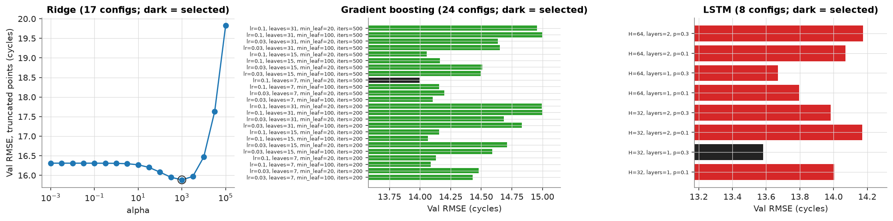

## 3. Official test results

**Primary — official uncapped RUL labels** (one prediction per engine at its last observed cycle, N = 100):

| Model | Seeds | RMSE | MAE | NASA score (sum) | NASA score / engine | Bias | Late frac. | RMSE 95% CI† |
|---|---|---|---|---|---|---|---|---|
| **Constant mean** | 1 | 41.88 | 36.15 | 18,982 | 189.82 | 5.22 | 0.45 | [37.94, 45.74] |
| **Life prior (cycle only)** | 1 | 36.76 | 28.02 | 23,109 | 231.09 | -3.00 | 0.54 | [30.65, 42.99] |
| **Ridge** | 1 | 16.74 | 13.49 | 459 | 4.59 | 0.48 | 0.51 | [14.33, 19.09] |
| **Gradient boosting** | 5 | 13.26 | 9.86 | 244 | 2.44 | 0.42 | 0.58 | [11.08, 15.30] |
| **LSTM** | 5 | 15.90 ± 0.42 | 11.89 ± 0.46 | 397 ± 23 | 3.97 ± 0.23 | 0.51 ± 0.43 | 0.63 | [13.33, 18.43] |

† Percentile bootstrap over test engines (2000 resamples) for the median-RMSE seed. ± is the sample std over seeds; deterministic models were trained once.

**Secondary — labels capped at R_max (literature-style):**

| Model | Seeds | RMSE | MAE | NASA score (sum) | NASA score / engine | Bias | Late frac. |
|---|---|---|---|---|---|---|---|
| **Constant mean** | 1 | 40.56 | 35.08 | 18,543 | 185.43 | 6.29 | 0.45 |
| **Life prior (cycle only)** | 1 | 36.06 | 26.95 | 21,037 | 210.37 | -1.93 | 0.54 |
| **Ridge** | 1 | 15.51 | 12.60 | 409 | 4.09 | 1.55 | 0.53 |
| **Gradient boosting** | 5 | 12.03 | 8.82 | 214 | 2.14 | 1.49 | 0.59 |
| **LSTM** | 5 | 14.71 ± 0.42 | 10.82 ± 0.46 | 361 ± 27 | 3.61 ± 0.27 | 1.58 ± 0.43 | 0.63 |

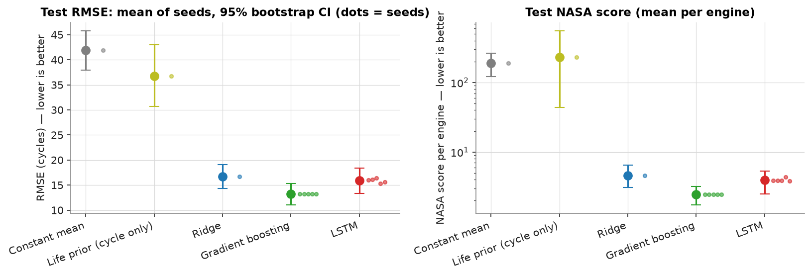

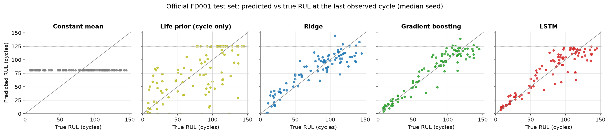

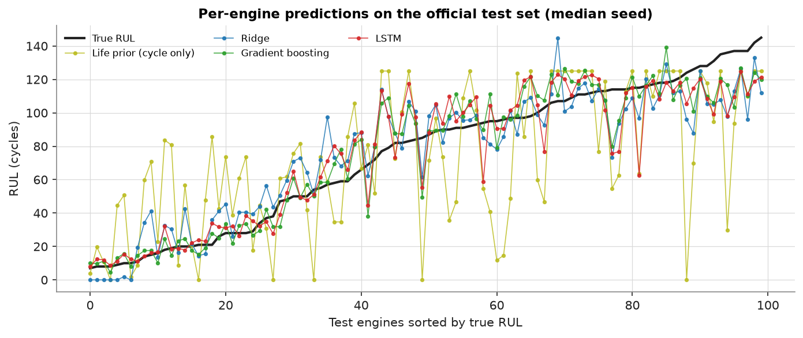

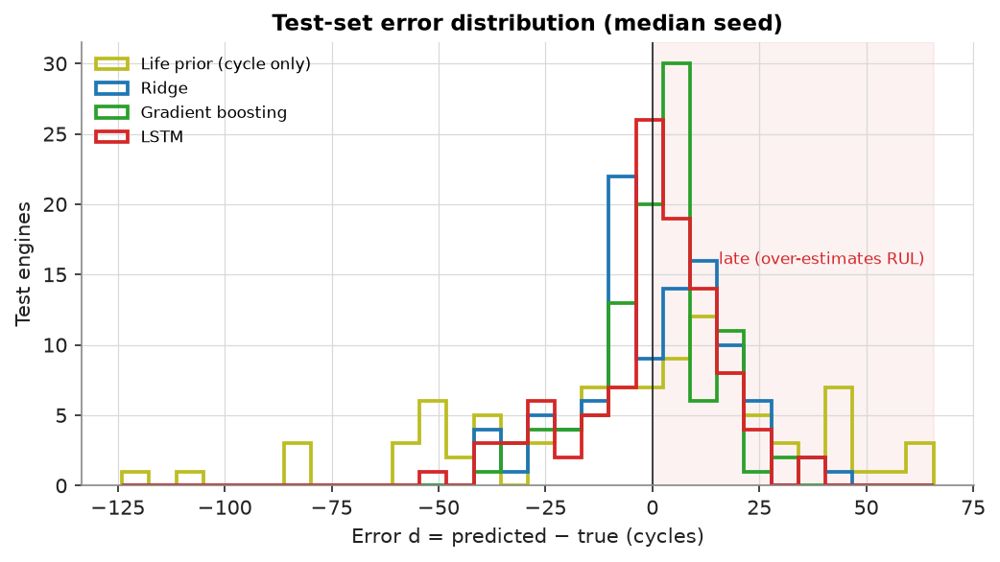

## 4. Paired comparisons (EVAL-28)

| Comparison (RMSE a − b) | Δ RMSE | 95% paired bootstrap CI | CI excludes 0 |
|---|---|---|---|
| LSTM − Gradient boosting | 2.74 | [0.38, 5.21] | yes |
| Ridge − Life prior (cycle only) | -20.02 | [-25.79, -14.23] | yes |
| Gradient boosting − Life prior (cycle only) | -23.50 | [-29.65, -17.29] | yes |
| LSTM − Life prior (cycle only) | -20.76 | [-26.76, -14.79] | yes |
| Life prior (cycle only) − Constant mean | -5.12 | [-12.62, 1.87] | no |

Negative Δ means model *a* has lower RMSE. Engines are resampled jointly for both models.

**Auto-generated findings:**

- Lowest mean test RMSE: **Gradient boosting** (13.26 cycles over 5 seed(s); NASA score 244).
- On validation (the selection data), **LSTM** had the lowest RMSE (13.75 vs 14.00 for Gradient boosting); the ranking flipped on the test set, a reminder of how noisy 20 validation engines are.
- LSTM has higher test RMSE than Gradient boosting (median seeds, Δ = +2.74, paired 95% CI [0.38, 5.21]).
- Ridge has lower test RMSE than Life prior (cycle only) (median seeds, Δ = -20.02, paired 95% CI [-25.79, -14.23]).
- Gradient boosting has lower test RMSE than Life prior (cycle only) (median seeds, Δ = -23.50, paired 95% CI [-29.65, -17.29]).
- LSTM has lower test RMSE than Life prior (cycle only) (median seeds, Δ = -20.76, paired 95% CI [-26.76, -14.79]).
- Life prior (cycle only) vs Constant mean: no clear difference on 100 test engines (Δ = -5.12, 95% CI [-12.62, 1.87] includes 0).

## 5. Performance by degradation stage

**Official test set (bins with n < 5 not scored)** — RMSE (cycles) vs uncapped truth:

| True RUL bin | [0, 25) | [25, 50) | [50, 75) | [75, 100) | [100, 125) | [125, inf) |
|---|---|---|---|---|---|---|
| n | 19 | 11 | 13 | 23 | 23 | 11 |
| Constant mean | 66.42 | 47.61 | 23.18 | 10.89 | 32.66 | 54.29 |
| Life prior (cycle only) | 35.10 | 26.54 | 26.64 | 43.15 | 37.59 | 42.05 |
| Ridge | 12.20 | 12.10 | 19.16 | 14.43 | 15.64 | 27.63 |
| Gradient boosting | 4.22 | 6.36 | 13.48 | 15.90 | 12.37 | 21.58 |
| LSTM | 4.96 | 6.10 | 14.95 | 18.69 | 18.49 | 23.24 |

Bias (mean predicted − true):

| True RUL bin | [0, 25) | [25, 50) | [50, 75) | [75, 100) | [100, 125) | [125, inf) |
|---|---|---|---|---|---|---|
| Constant mean | 66.21 | 47.01 | 22.12 | -9.00 | -32.17 | -53.99 |
| Life prior (cycle only) | 21.11 | 12.19 | 2.27 | -11.17 | -11.59 | -31.07 |
| Ridge | 2.30 | 10.55 | 15.18 | 3.90 | -5.47 | -24.82 |
| Gradient boosting | 1.21 | -1.34 | 4.88 | 7.00 | 1.39 | -20.25 |
| LSTM | 2.77 | 0.91 | 7.93 | 8.15 | -5.16 | -21.51 |

**Validation engines, every window** — RMSE (cycles) vs uncapped truth:

| True RUL bin | [0, 25) | [25, 50) | [50, 75) | [75, 100) | [100, 125) | [125, inf) |
|---|---|---|---|---|---|---|
| n | 500 | 500 | 500 | 500 | 483 | 1031 |
| Constant mean | 69.12 | 44.33 | 20.08 | 9.55 | 31.95 | 90.77 |
| Life prior (cycle only) | 28.85 | 33.06 | 37.39 | 36.59 | 32.33 | 59.32 |
| Ridge | 9.58 | 18.05 | 19.90 | 13.76 | 14.86 | 57.83 |
| Gradient boosting | 3.98 | 10.06 | 18.45 | 18.16 | 14.80 | 55.87 |
| LSTM | 4.01 | 8.66 | 16.26 | 19.51 | 14.19 | 57.26 |

Bias (mean predicted − true):

| True RUL bin | [0, 25) | [25, 50) | [50, 75) | [75, 100) | [100, 125) | [125, inf) |
|---|---|---|---|---|---|---|
| Constant mean | 68.74 | 43.74 | 18.74 | -6.26 | -31.12 | -84.91 |
| Life prior (cycle only) | 13.37 | 7.43 | 3.41 | -1.37 | -9.82 | -49.71 |
| Ridge | 1.32 | 14.69 | 16.26 | 7.96 | -7.49 | -50.43 |
| Gradient boosting | -0.31 | 2.47 | 8.89 | 7.00 | -2.99 | -47.07 |
| LSTM | 2.03 | 2.83 | 5.30 | 7.67 | -4.12 | -48.37 |

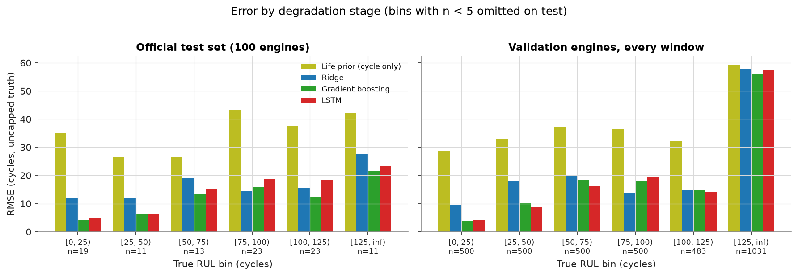

Errors in the `[125, inf)` bin are partly irreducible for models trained on targets capped at 125 (ADR-03).

## 6. Error analysis — largest test errors (median seed)

**Gradient boosting**

| Unit | Observed length | True RUL | Predicted | Error |
|---|---|---|---|---|
| 93 | 244 | 85 | 49.4 | -35.6 |
| 45 | 152 | 114 | 79.7 | -34.3 |
| 55 | 113 | 137 | 103.3 | -33.7 |
| 3 | 126 | 69 | 38.2 | -30.8 |
| 50 | 74 | 79 | 109.0 | 30.0 |
| 67 | 71 | 77 | 105.6 | 28.6 |
| 96 | 97 | 137 | 110.0 | -27.0 |
| 25 | 48 | 145 | 119.9 | -25.1 |
| 73 | 112 | 131 | 105.9 | -25.1 |
| 74 | 137 | 126 | 101.0 | -25.0 |

**LSTM**

| Unit | Observed length | True RUL | Predicted | Error |
|---|---|---|---|---|
| 30 | 143 | 115 | 62.7 | -52.3 |
| 45 | 152 | 114 | 75.6 | -38.4 |
| 89 | 177 | 136 | 98.2 | -37.8 |
| 51 | 144 | 114 | 76.8 | -37.2 |
| 67 | 71 | 77 | 113.4 | 36.4 |
| 70 | 152 | 94 | 58.7 | -35.3 |
| 15 | 76 | 83 | 117.4 | 34.4 |
| 73 | 112 | 131 | 99.0 | -32.0 |
| 93 | 244 | 85 | 55.3 | -29.7 |
| 55 | 113 | 137 | 109.6 | -27.4 |

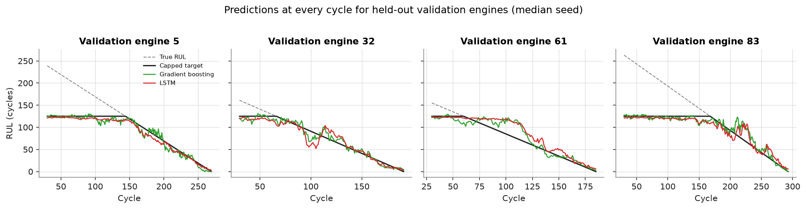

## 7. Feature importance (validation set only)

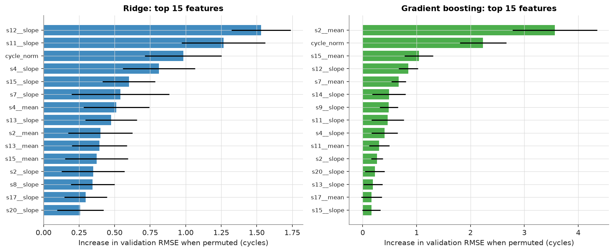

Ridge — 10 largest standardized coefficients:

| Feature | Coefficient (cycles per std) |
|---|---|
| s11__slope | -4.57 |
| s12__slope | 4.39 |
| s7__slope | 3.62 |
| s4__slope | -3.33 |
| cycle_norm | -3.17 |
| s2__slope | -3.04 |
| s13__slope | -2.88 |
| s15__slope | -2.59 |
| s20__slope | 2.53 |
| s4__mean | -2.51 |

## 8. LSTM training curves

Median seed: 46 epochs run, best epoch 36, 0.45 s/epoch on cpu.

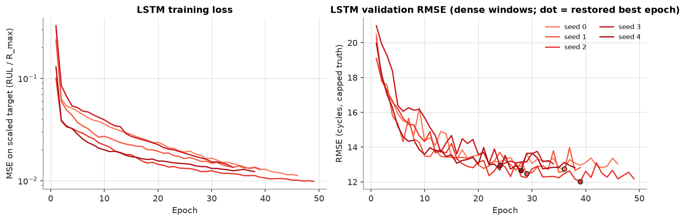

## 9. Computational benchmarks (measured)

| Model | Inference device | Train time (s, CPU) | Epochs | Latency median (ms) | Latency p95 (ms) | Throughput (windows/s, batch 100) | Params / tree nodes | Artifact bytes |
|---|---|---|---|---|---|---|---|---|
| Constant mean | cpu | 0.00 | – | 0.001 | 0.001 | 133,332,318 | 1 | 49 |
| Life prior (cycle only) | cpu | 0.02 | – | 0.001 | 0.001 | 66,666,159 | 1 | 61 |
| Ridge | cpu | 0.06 | – | 0.118 | 0.122 | 332,617 | 58 | 3,561 |
| Gradient boosting | cpu | 1.41 | – | 10.412 | 25.314 | 6,898 | 6,500 | 578,066 |
| LSTM | cpu | 20.71 | 46 | 0.170 | 0.174 | 33,901 | 6,817 | 31,159 |
| LSTM | mps | 20.71 | 46 | 0.796 | 0.971 | 101,656 | 6,817 | 31,159 |

Latency: batch of 1 window, 20 warm-up + 200 timed calls, including feature extraction for tabular models. Training time is wall-clock for one run. Comparable only within this machine.

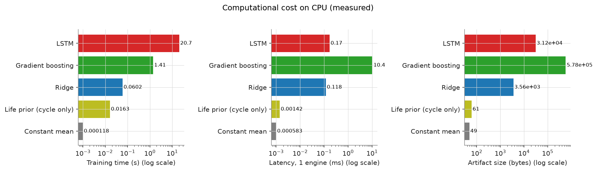

## 10. Sensitivity study (validation only, seed 0)

| Model | R_max | Window W | Val RMSE (truth capped at 125) | Val RMSE (uncapped truth) |
|---|---|---|---|---|
| Gradient boosting | 115 | 20 | 15.11 | 33.45 |
| Gradient boosting | 115 | 30 | 14.49 | 33.41 |
| Gradient boosting | 125 | 20 | 15.48 | 30.79 |
| Gradient boosting | 125 | 30 | 14.00 | 30.52 |
| Gradient boosting | 135 | 20 | 17.43 | 29.10 |
| Gradient boosting | 135 | 30 | 16.27 | 28.77 |
| Gradient boosting | none | 20 | 34.17 | 30.52 |
| Gradient boosting | none | 30 | 32.24 | 28.68 |
| LSTM | 115 | 20 | 15.23 | 34.46 |
| LSTM | 115 | 30 | 14.21 | 34.04 |
| LSTM | 125 | 20 | 14.67 | 32.04 |
| LSTM | 125 | 30 | 13.58 | 31.10 |
| LSTM | 135 | 20 | 15.43 | 29.40 |
| LSTM | 135 | 30 | 14.57 | 28.62 |
| LSTM | none | 20 | 29.02 | 25.28 |
| LSTM | none | 30 | 25.71 | 24.09 |

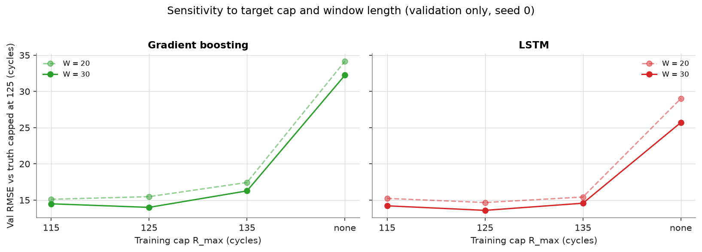

## 11. Test-set usage log

`results/test_evaluations.jsonl` holds 13 entries across 1 evaluation round(s). Notes recorded per round:

- 2026-11-11T03:38 UTC: first and only planned evaluation of frozen final configs (EXP-06)

See `docs/decisions.md` → *Post-test changes* for any change made after a test evaluation.

## 12. Limitations

- Simulated data (C-MAPSS); not validated for real engines, maintenance planning or flight safety.
- Single subset (FD001: one operating condition, one fault mode).
- One fixed 80/20 engine split; final models are not retrained on all 100 engines, and split variance is not captured.
- Only 100 test engines: confidence intervals are wide; small differences are not distinguishable.
- Models trained on targets capped at 125 cannot predict long RULs exactly (see stage table).
- Mirror provenance: files match pinned checksums, but byte-identity with NASA's original ZIP is unverified.
- Published results use different protocols; see `docs/external_results.md` — no ranking against them is claimed.
